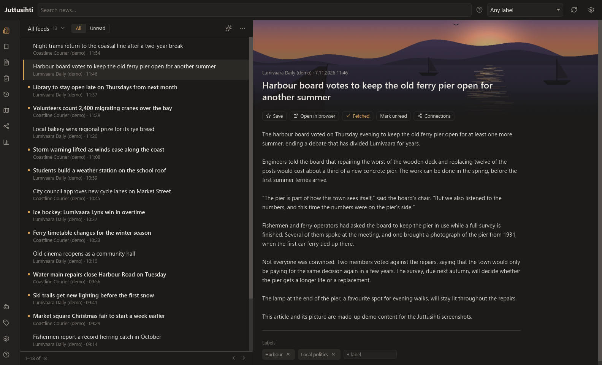
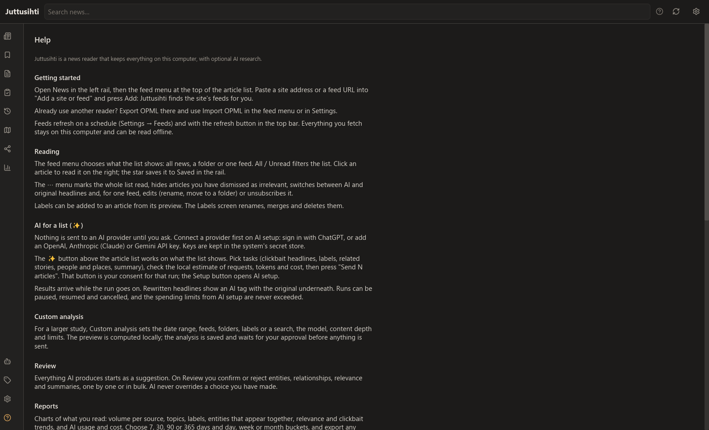
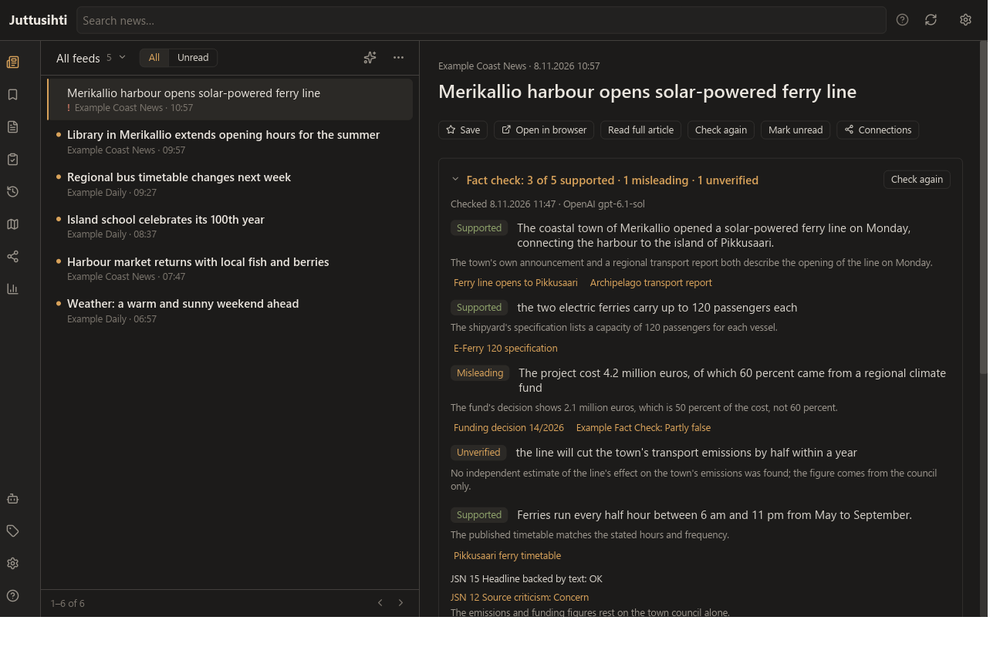
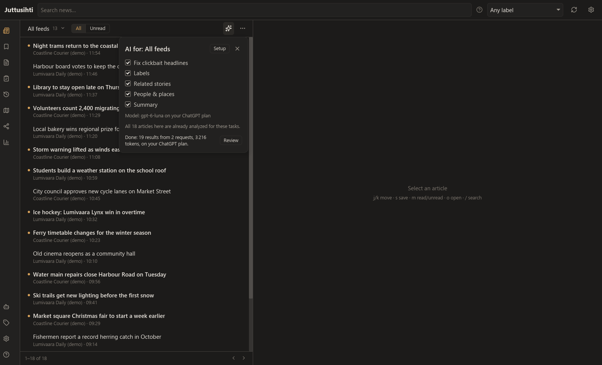
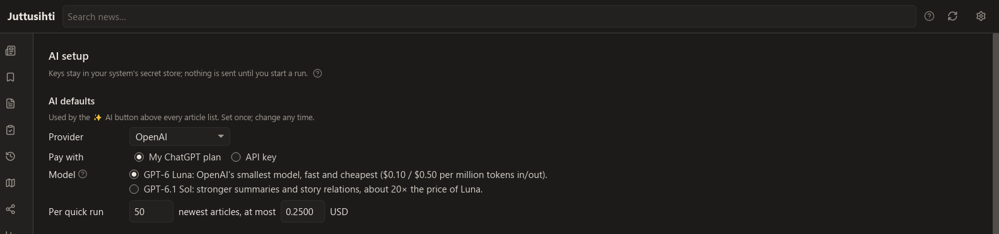
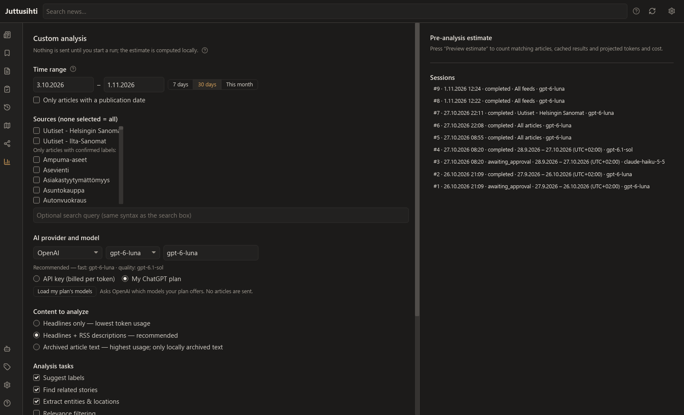
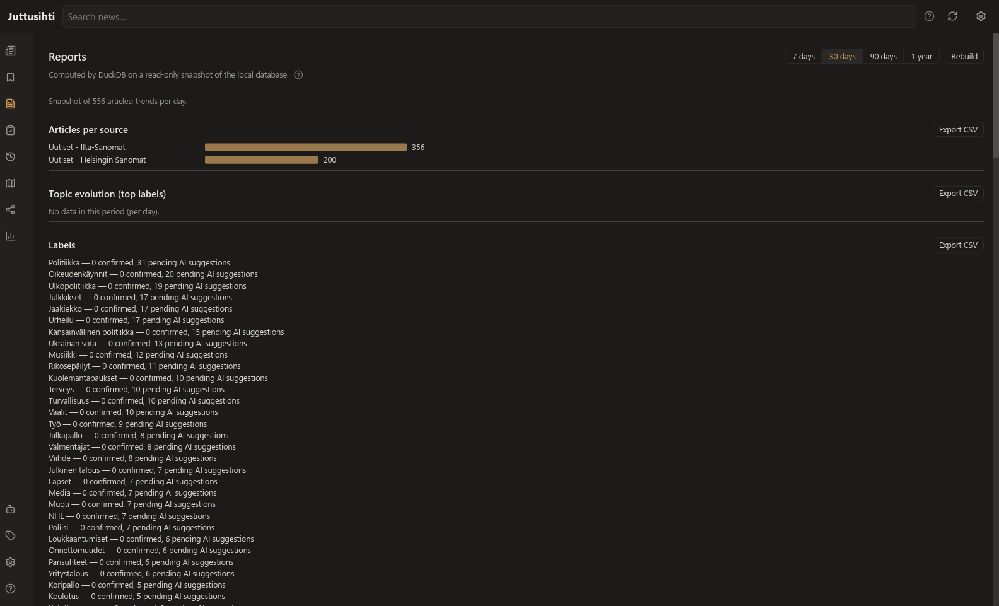
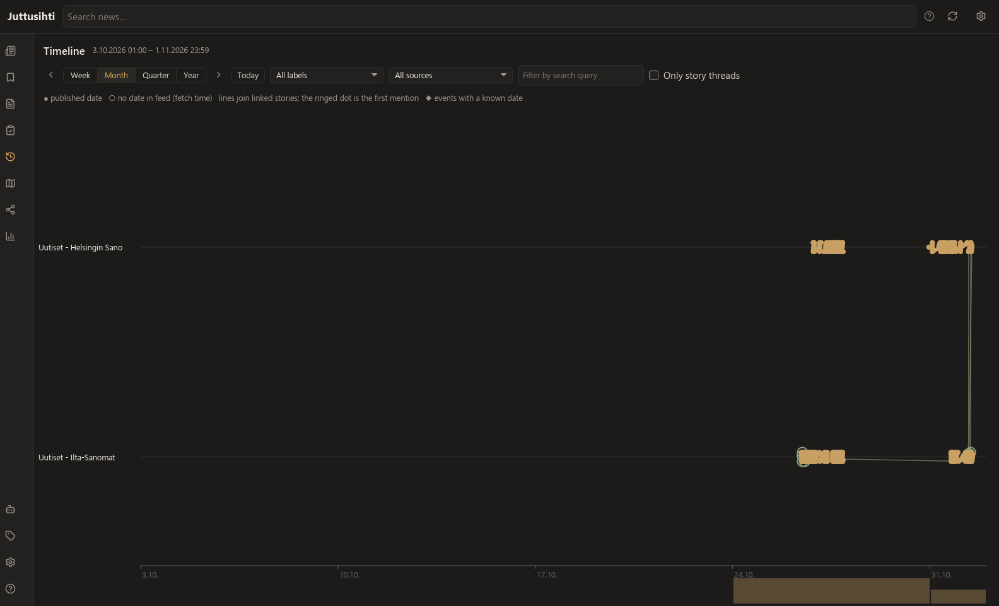
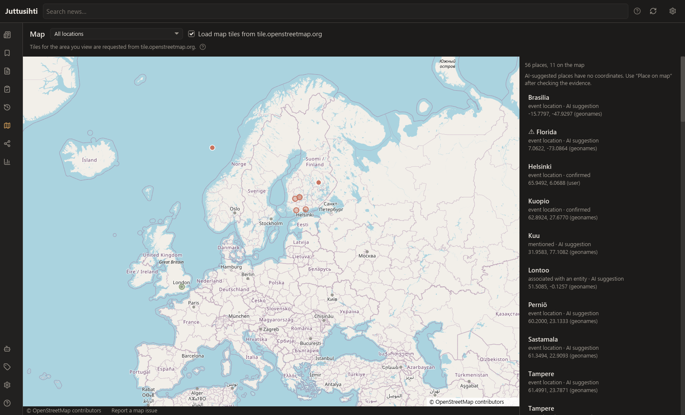
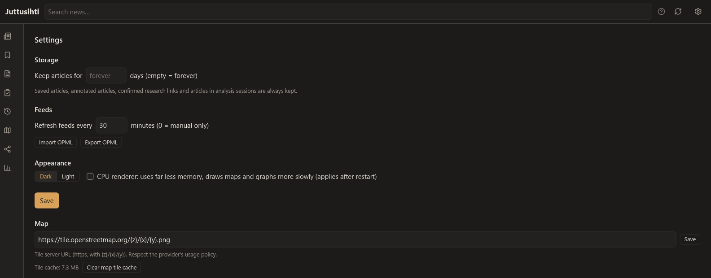

# Juttusihti

[](https://github.com/tero-k/juttusihti/actions/workflows/ci.yml)
[](https://github.com/tero-k/juttusihti/releases)
[](#license)

**A local-first RSS reader and news research desktop app for Windows and Linux.**

Juttusihti reads RSS, Atom and JSON feeds offline with fast full-text search, and turns your
news into research: labels, people and places, story threads, timelines, maps and reports.
AI analysis (OpenAI, Anthropic, Gemini) is optional and only ever starts when you ask for it,
after showing what it will send and what it will cost. Written in Rust with
[Iced](https://iced.rs); SQLite is the source of truth and DuckDB runs the reports.



## Features

- **Reader**: subscribe by site or feed address (feeds are discovered for you), folders, OPML
  import and export, unread and saved views, scheduled refresh, offline reading and keyboard
  shortcuts.
- **Full articles**: when a feed only gives a teaser, one click (or **a**) loads the article in a
  throwaway private browser, blocks known trackers and ads, accepts cookie banners, keeps the
  text and the main picture, and deletes the browser profile. Nothing is fetched until you ask.
- **Search**: local FTS5 full-text search with phrases, `OR`, `NOT`, prefixes, field filters
  and `NEAR`, plus a label filter next to the search box.
- **AI on your terms**: one click (✨) for the list you are looking at, or a custom analysis
  for a date range. Every run shows a local estimate of articles, tokens and cost, needs your
  consent and stays within spending limits. Sign in with ChatGPT, or use your own OpenAI,
  Anthropic or Gemini API key (kept in the system's secret store).
- **Clickbait headlines rewritten** from the article text, shown with an AI tag and the
  original underneath. With an OpenAI API key, a cheap clickbait check picks out the headlines
  worth rewriting first.
- **Fact check**: one button in the reader has an AI check an article's factual claims against
  web sources, Wikipedia and published fact checks, and against the Finnish journalists'
  guidelines. It starts only when you press it, after showing what is sent where and the limit.
- **Review**: everything AI produces is a suggestion until you confirm it.
- **Reports**: volume per source, topics, labels, co-occurring entities, relevance and AI cost,
  with CSV export.
- **Timeline, map and relationship map** of stories, places, people and organisations.
  OpenStreetMap tiles are opt-in.
- **Calm interface**: an icon rail, warm paper colours with amber accents in light and dark
  themes, a CPU renderer for low memory use, and a built-in Help screen (**F1**).
- **Private by default**: all data is in one SQLite database on your computer. Nothing is sent
  anywhere you did not ask for. Screenshots in this README use made-up demo news.

## Download

Get the latest version from [GitHub Releases](https://github.com/tero-k/juttusihti/releases).
What changed in each version: [CHANGELOG.md](CHANGELOG.md).

| System | File | Install |
| --- | --- | --- |
| Windows 10/11 (x64) | `juttusihti_X.Y.Z_x64-setup.exe` | Run it. Installs for the current user; no administrator rights needed. |
| Windows, portable | `juttusihti-X.Y.Z-x86_64-windows.zip` | Unzip and run `juttusihti.exe`. |
| Debian, Ubuntu 22.04+ | `juttusihti_X.Y.Z_amd64.deb` | `sudo apt install ./juttusihti_X.Y.Z_amd64.deb` |
| Fedora, openSUSE, RHEL 10 and other RPM systems | `juttusihti-X.Y.Z-1.x86_64.rpm` | `sudo dnf install ./juttusihti-X.Y.Z-1.x86_64.rpm` (openSUSE: `sudo zypper install`) |
| Other Linux (x86_64) | `juttusihti_X.Y.Z_x86_64.AppImage` | `chmod +x` it and run it. |
| Linux, plain binary | `juttusihti-X.Y.Z-x86_64-linux.tar.gz` | Unpack and run `juttusihti`; needs the libraries listed under [Build from source](#build-from-source). |

Windows files are code-signed. Every release lists SHA-256 checksums in
`SHA256SUMS-linux.txt` and `SHA256SUMS-windows.txt`:

```sh
sha256sum -c SHA256SUMS-linux.txt --ignore-missing
```

Linux packages are built by GitHub Actions and carry
[build provenance attestations](https://docs.github.com/actions/security-for-github-actions/using-artifact-attestations):

```sh
gh attestation verify juttusihti_X.Y.Z_amd64.deb --repo tero-k/juttusihti
```

## Build from source

Requirements: Rust 1.85+ (2024 edition) and a C/C++ toolchain, because SQLite and DuckDB are
bundled and compiled from source. The full-article browser engine `juttusihti-browser` (see below)
needs Rust 1.88+. On Windows this means MSVC (VS 2022 Build Tools); CMake and
NASM are not needed. A first build of bundled DuckDB takes several minutes.

On Linux, install the development libraries first:
- Debian/Ubuntu: `libdbus-1-dev libxkbcommon-dev libwayland-dev libx11-dev libxcursor-dev
  libxi-dev libxrandr-dev libfontconfig1-dev libfreetype-dev`
- Fedora: `dbus-devel libxkbcommon-devel wayland-devel libX11-devel libXcursor-devel libXi-devel
  libXrandr-devel fontconfig-devel freetype-devel`

```sh
git clone https://github.com/tero-k/juttusihti.git
cd juttusihti
cargo run --release -p juttusihti
```

**Full articles need one more build command.** The app's browser engine, based on
[Servo](https://servo.org), is built as `juttusihti-browser` from its own cargo workspace
(`crates/browser`, with its own `Cargo.lock`, Rust 1.88+), so `cargo build --workspace` does not
build it. Build it into the same `target` folder, so the app finds it next to itself (or point
`JUTTUSIHTI_BROWSER` at it):

```sh
cargo build --release --locked --manifest-path crates/browser/Cargo.toml --target-dir target
```

Do not run a plain `cargo update` there: the lock file pins a pre-release crate. Servo also
needs LLVM/clang (set `LIBCLANG_PATH` if it is not found) and, for the first build, network
access to download a prebuilt SpiderMonkey; the first build takes a few minutes. On Windows it
needs a working OpenGL driver at run time. On Debian/Ubuntu add `clang libclang-dev cmake
pkg-config python3 libegl1-mesa-dev libgles2-mesa-dev libglib2.0-dev libharfbuzz-dev
libxcb-render0-dev libxcb-shape0-dev libxcb-xfixes0-dev`; at run time it needs `libegl1`, and
with no GPU or display Mesa's `libegl-mesa0` and `libgl1-mesa-dri` (software OpenGL). The Linux
dependency list is checked in CI on Ubuntu 22.04 but not yet on a clean desktop machine. Without
the browser engine the rest of the app works as before: the **Read full article** button is
still shown, and pressing it reports that the browser engine is missing.

## Using Juttusihti

The same guide is built into the app: click **?** at the bottom of the left rail, or press
**F1**.



### Getting started

1. Open **News** (the newspaper icon at the top of the left rail).
2. Open the feed menu at the top left of the article list. Paste a site address or a feed URL
   into **Add a site or feed** and press **Add**. Juttusihti finds the site's feeds for you.
3. Coming from another reader? Export OPML there and use **Import OPML** in the feed menu or
   in Settings.

Feeds refresh on a schedule (Settings → Feeds, every 30 minutes by default) and with the
refresh button in the top bar. Everything you fetch stays on this computer and can be read
offline.

### Reading

- The feed menu chooses what the list shows: all news, a folder or a single feed. **All /
  Unread** filters the list.
- Click an article to read it on the right. **Save** keeps it under **Saved** in the rail and
  protects it from the retention clean-up; **Open in browser** opens the original page.
- The **⋯** menu marks the list read, hides articles you have dismissed as irrelevant,
  switches between AI-rewritten and original headlines and, for a single feed, renames it,
  moves it to a folder or unsubscribes.
- Add labels to an article from its preview. The **Labels** screen renames, merges and deletes
  them.
- **Read full article** (shortcut **a**) fetches the whole article when the feed only has a
  teaser; see [Full articles](#full-articles).
- **Fact check** has an AI check the article's claims; see [Fact check](#fact-check).

### Full articles

Many feeds give only a headline and a teaser. To read the whole story inside Juttusihti:

1. Open the article in the reader.
2. Press **Read full article** next to **Open in browser**, or press **a**. The button shows
   **Fetching…** for about 5 to 10 seconds.
3. The whole text replaces the teaser and the button says **Fetched**. The main picture is
   shown faded behind the headline. The article now opens instantly, also offline.

Subscriber-only articles keep only the part the site shows everyone, with the note "The rest
of this article is for subscribers." Juttusihti never gets around a paywall. If a fetch does
not work, the reader says why: "Couldn't find the article text on the page." (this is also
what a site that refuses the visit looks like) or "The site took too long to answer." The
teaser and **Open in browser** stay as they were.

Fetched text is included in search, and in **Custom analysis** when you choose **Archived
article text**.

#### Privacy

Nothing is fetched until you press the button. Then Juttusihti's built-in browser engine loads
the page in the background, with no window and a brand-new, empty profile, so the site sees a
stranger with no earlier cookies or logins:

- Known trackers and ads are blocked with the EasyList and EasyPrivacy lists, which ship with
  the app; no rules are downloaded at run time.
- Cookie banners are accepted automatically, including the free choice of "consent or pay"
  walls, so you never click one. This is deliberate: the alternative is often a page with no
  text. Because the profile is new, the cookies only live for that one visit.
- When the text and the main picture are saved, the whole profile, cookies, storage and cache
  included, is deleted, so the next visit cannot be linked to this one. If the engine crashes
  or hangs, the profile is still deleted, and any leftovers are cleared when the app starts.
- The site still sees your IP address, as with any visit.
- The text and picture are stored on this computer, apart from the feed. They are never sent
  to an AI provider unless you include the article in an AI run.

#### Cache

Settings → **Full articles**:

- **Download pictures**: on by default. Off means text only; the picture is never requested.
- **Cache size limit**: 500 MB by default. When the cache is full, the oldest fetched articles
  fall back to their feed teaser first; they can be fetched again. Saved articles are never
  removed to make room.
- **Clear cache now** removes all fetched text and pictures.

### Fact check

Press **Fact check** in the reader, after **Read full article**, to have an AI check the factual
claims of an article. It needs the full text: until the article is fetched (or the feed gave at
least 300 characters of full content) the button is disabled, and its tooltip says "Load the full
article first". Once there is a result it says **Check again**.

The button only opens a panel with the provider and its Quality model, what will be sent where,
an estimate and the limit for one check. Nothing is sent until you press
`Check with <provider>`:

- the article goes to your AI provider;
- the claims go to [Google Fact Check Tools](https://developers.google.com/fact-check/tools/api),
  only if you added a key;
- searches go to Wikipedia.

The AI picks up to 8 checkable factual claims (opinions are skipped), searches the web with the
provider's own search (up to 3 searches per claim), looks up Wikipedia and, with a key,
published fact checks. Each claim gets a verdict: **Supported**, **Contradicted**,
**Misleading**, **Unverified** or **Not checked (limit reached)**. Sources from the article's own
site or copies of the same story do not count, Wikipedia is only background, and a verdict needs
a real source found during the check, otherwise it becomes Unverified. Published fact checks
show the publisher and the rating as published.

The article is also checked against the Finnish journalists' guidelines
([Journalistin ohjeet](https://jsn.fi/journalistin-ohjeet/)): JSN 15 (the headline is backed by
the text), 12 (source criticism), 21 (right to reply) and 16 (hidden advertising).

The result appears above the article as a score, such as "Fact check: 2 of 8 supported ·
1 contradicted · 5 unverified"; click it to see each claim with its verdict, reason and sources,
and the guideline checks. Under the score a short note reminds that the check was made with AI and
is a helpful guide rather than a guarantee. "Reduced check: web search was not available." means
the model or plan could not search the web. A red **!** in the article list marks articles whose check found
contradicted or misleading claims.



**AI setup → Fact check** sets the limit per check ($1.00 by default) and the optional Google
Fact Check Tools API key (free from Google Cloud), kept in the system's secret store. Each claim
sets aside the most it could cost before it starts; if a check reaches the limit, the remaining
claims are marked Not checked, so raise the limit to check more. On a ChatGPT plan the limit does
not apply (a plan check costs no money) and the plan's own usage limits apply instead. Web
searches can run slightly over the limit with OpenAI and Gemini. Any article language works;
explanations are in English. Only the latest check per article is kept, and if credit or sign-in
runs out the check stops without replacing an earlier result.

How the check works in detail (prompts, evidence rules, cost limits, storage and code) is in
[docs/fact-check.md](docs/fact-check.md).

### Searching

Type in the search bar at the top (or press `/`). Search is local full-text search.
The label menu next to it narrows the list to articles with one label (confirmed labels only,
not pending AI suggestions); it works with or without search text, and **Clear** resets both.

| Query | Finds |
| --- | --- |
| `tram strike` | both words (AND is implicit) |
| `"city council"` | the exact phrase |
| `tram OR bus` | either word |
| `-sports` or `NOT sports` | leaves out articles with the word |
| `työttömyysturva*` | prefix; needed for Finnish inflections such as `työttömyysturvaan` |
| `title:sää` | only in the title (also `author:`, `summary:`, `content:`) |
| `NEAR(rail budget, 10)` | words within 10 words of each other; `( )` groups terms |

### Keyboard shortcuts

| Keys | Action |
| --- | --- |
| `j` / `↓`, `k` / `↑` | next / previous article |
| `o` / `Enter` | open the article in the browser |
| `a` | read the full article in the reader |
| `s` | save or unsave |
| `m` | mark read or unread |
| `n` / `p` | next / previous page |
| `/` or `Ctrl+F` | search |
| `Ctrl+R` | refresh all feeds |
| `Esc` | close menus and panels |
| `F1` | help |

### AI for a list (✨)

Nothing is sent to an AI provider until you ask.

1. Connect a provider on **AI setup** (the robot icon): sign in with ChatGPT, or add an
   OpenAI, Anthropic (Claude) or Gemini API key. The screen explains step by step how to get a
   key. Keys are stored in the system's secret store, never in the database. Set the default
   provider, Fast/Quality model and per-run spending limits here too.
2. Press **✨** above the article list. It works on what the list shows: a feed, a folder, a
   view or a search.
3. Pick tasks (clickbait headlines, labels, related stories, people and places, summary), check the
   local estimate of articles, requests, tokens and cost, and press **Send N articles to
   &lt;provider&gt;**. That button is your consent for that run.



Results show up in the list while the run goes on. Rewritten headlines carry an AI tag with
the original underneath. Runs can be paused, resumed and cancelled, and never exceed the
spending limits.

**Clickbait check.** With an OpenAI API key, headlines are checked before they are rewritten:
a fast, cheap classifier (OpenAI's Decisions API, `gpt-6-luna`) rates how likely each headline
is clickbait, in batches, and only those at or above the threshold (70% by default) are sent
to the rewriting model. Ratings are cached, so a new threshold costs nothing. Turn the check off
or change the threshold on **AI setup**. With Claude or Gemini, headlines are rewritten in one
step without the check.

**Ways to pay with OpenAI.** **Pay with** on **AI setup** and in **Custom analysis** has three
choices:

- **My ChatGPT plan**: everything counts against the plan, and headlines are rewritten in one
  step without the check.
- **API key**: everything is billed per token to the API account, including the check.
- **ChatGPT plan, with API credit for the clickbait check**: the check is billed to the API
  account and everything else counts against the plan. This needs both the sign-in and a key.

**API credit.** An API key is billed to the provider account behind it, which needs credit; a
ChatGPT plan is not. If your OpenAI API account runs out of credit, the run pauses at once and
says so instead of retrying. The exception is the split choice above: the plan still pays for
the rewrites, so the run goes on without the check and sends every headline for a rewrite. Add
credit on
[OpenAI's billing page](https://platform.openai.com/settings/organization/billing/), then press
**Resume** under **Custom analysis**: finished work is kept and never paid for twice.



### Custom analysis

For a larger study, **Custom analysis** chooses a date range, feeds, folders, labels or a
search, the model, how much of each article to send, tasks and limits. Its preview is
computed locally; the analysis is saved and waits for your approval before anything is sent.
Recent runs are listed there too, including ✨ runs; a paused or stopped run shows why it
stopped and has a **Resume** button.



### Review

Everything AI produces starts as a suggestion. On **Review** you confirm or reject entities,
relationships, relevance and summaries, one by one or in bulk. AI never overrides a choice you
have made.

### Reports

Charts of your news: volume per source, topics, labels, entities that appear together,
relevance and clickbait trends, and AI usage and cost. Choose 7, 30, 90 or 365 days and day,
week or month buckets, and export any report as CSV.



### Timeline, map and relationship map

- **Timeline** shows articles per source, story threads and dated events. Drag to pan, scroll
  to zoom.
- **Map** shows places from articles. Map tiles stay off until you turn them on, because the
  area you view is then sent to the tile server; without them a coordinate grid is shown.
  Places named by AI have no coordinates: check the evidence and use **Place on map**.
- **Relationship map** draws people, organisations and places and how they connect: solid
  lines are confirmed, dashed lines are AI suggestions.




### Settings and your data

Settings sets how long articles are kept (saved and researched articles are always kept), the
refresh interval, dark or light theme, the CPU renderer (far less memory), full-article
pictures and cache size (see [Full articles](#full-articles)), and the map tile server and its
cache.



All data is in one SQLite database on this computer; its path is shown at the bottom of
Settings. Set `JUTTUSIHTI_DATA_DIR` to keep it somewhere else.

## Development

### Workspace

| Crate | Purpose | Network | AI |
| --- | --- | --- | --- |
| `crates/core` (`juttusihti-core`) | Domain model, SQLite schema + migrations, FTS5 search, feed parsing, OPML, discovery, research data model | no | no |
| `crates/fetch` (`juttusihti-fetch`) | HTTP fetching: conditional requests, timeouts, bounded retries, size limits, discovery | yes | no |
| `crates/ai` (`juttusihti-ai`) | OpenAI / Anthropic / Gemini clients, prompts and output validation, the approved-session runner | yes, only for approved runs | yes |
| `crates/analytics` (`juttusihti-analytics`) | DuckDB reports over a consistent SQLite snapshot, on a bounded, cancellable worker | no | no |
| `crates/app` (`juttusihti`) | Iced 0.14 desktop UI | via `fetch` | no |
| `crates/article` (`juttusihti-article`) | Messages between the app and its browser engine, picture re-encoding | no | no |
| `crates/browser` (`juttusihti-browser`) | Full-article browser engine: Servo with no window, tracker blocking, cookie consent, article extraction. Its own cargo workspace | yes, only when you press Read full article | no |
| `crates/bench` | Benchmarks at 10k/100k/1M articles (BENCHMARKS.md) | no | no |

### Build, test and run

See [Build from source](#build-from-source) for requirements.

```sh
cargo fmt --all --check
cargo clippy --workspace --all-targets -- -D warnings
cargo test --workspace          # no network or paid API needed
cargo run -p juttusihti         # data in the OS data dir; override with JUTTUSIHTI_DATA_DIR
```

Debug info is turned off for dependencies (`[profile.dev.package."*"]`): with it on, the debug
`target/` grew past 16 GB.

Logging: `JUTTUSIHTI_LOG=debug`. Panics also go to `crash.log` in the data dir, which stays on the
computer and can quote feed text, so read it before sharing it. Renderer: GPU by default; `ICED_BACKEND=tiny-skia` or
Settings → CPU renderer uses far less memory (see BENCHMARKS.md).

### CI and releases

- **CI** (`.github/workflows/ci.yml`, on pushes to `master` and pull requests): `cargo fmt`,
  clippy with `-D warnings` and tests on Ubuntu 22.04 and Windows (the app workspace and the
  separate `crates/browser` workspace), and `cargo audit`.
- **Release** (`.github/workflows/release.yml`, on `v*` tags): runs CI, builds the Linux
  `.deb`, `.rpm`, AppImage and tarball with checksums and provenance attestations, and puts them on a
  **draft** GitHub Release. The Windows installer is built and signed locally with
  `packaging/release-windows.ps1` and added to the draft, which is then published by hand.
  Step by step: [RELEASING.md](RELEASING.md).
- **Dependabot** proposes Cargo updates weekly and GitHub Actions updates monthly. Actions are
  pinned by commit SHA.

### Packages

Unsigned local packages, for testing. `beforePackagingCommand` in `Packager.toml` builds both
the app and `juttusihti-browser`, and every format ships both binaries; for the `.rpm`, build the
browser engine first with the command under [Build from source](#build-from-source):

```sh
cargo install cargo-packager --version 0.11.8 --locked
cargo packager --release -f nsis -c Packager.toml            # Windows: per-user NSIS installer
APPIMAGE_EXTRACT_AND_RUN=1 cargo packager --release -f deb,appimage -c Packager.toml   # Linux
cargo install cargo-generate-rpm --version 0.21.1 --locked
cargo build --release -p juttusihti && cargo generate-rpm -p crates/app   # Linux .rpm (browser engine built first)
```

- **Build Linux packages on Ubuntu 22.04** (glibc 2.35), for example in a container. Built on
  Fedora 44 instead, the binary needs glibc 2.43 and will not run on Ubuntu 24.04 (glibc 2.39).
- **`name` is set in `Packager.toml` on purpose.** Without it, cargo-packager 0.11.8 tries to
  change directory into the config file.
- **The `.rpm` comes from cargo-generate-rpm**, because cargo-packager has no rpm format. Its
  files and run-time library requirements are in `[package.metadata.generate-rpm]` in
  `crates/app/Cargo.toml`; it lands in `target/generate-rpm/`.
- Packages land in `target/packages/`.

## Milestone 0 findings (verified 2026-10-25, Windows 11 x64, rustc 1.99.1, MSVC 14.44)

| Component | Version | Result |
| --- | --- | --- |
| iced | 0.14.0 | Builds; app window starts. Defaults to wgpu with a tiny-skia fallback. |
| rusqlite | 0.41.0, bundled SQLite 3.54.1 | FTS5 available. |
| duckdb-rs | 1.20000.0 | Builds and links in the same binary as bundled SQLite (no symbol clashes). **Reports `v2.0.0-dev88614`: a DuckDB development build, not a stable release.** |
| DuckDB `sqlite` extension | — | **Unavailable**: duckdb-rs does not bundle it, and `INSTALL sqlite` returns HTTP 404 from extensions.duckdb.org for this dev build (`cargo test -p juttusihti-analytics --test extension_probe -- --ignored`). |
| reqwest | 0.13 (rustls, aws-lc-rs) | Builds on Windows without CMake or NASM. |
| feed-rs / opml | 3.0.0 / 1.1.6 | RSS 2.0, Atom and JSON Feed fixtures parse. |

Decisions that follow from these findings:

- **The DuckDB snapshot is the integration path, not a fallback.** The analytics worker opens
  SQLite read-only, copies the analytical tables inside a single read transaction into an
  in-memory DuckDB, then runs fixed report queries there. It never holds a SQLite write lock.
- **The DuckDB instance is locked down**: extension autoload and autoinstall are off, external
  file and network access are disabled, memory and thread limits are set, and
  `lock_configuration` is on. Tests check that `INSTALL`, `LOAD`, `ATTACH`, `COPY TO`,
  `read_csv` and attempts to change these settings all fail. There is no free-form SQL entry
  point.
- duckdb-rs 1.20000 is a production risk because it bundles a dev build. Before release,
  either wait for a stable DuckDB 2.0 or pin `duckdb = "~1.10505"` (DuckDB 1.5.x). Nothing in
  this repo depends on 2.0-only features.
- Bucketing by time zone uses a fixed UTC offset. DST-correct zones need the ICU extension,
  which is not bundled.
- **Not verified yet: Linux (GNOME/KDE, Wayland/X11).** All results above are Windows-only.

### Finnish search

The FTS5 tokenizer is `unicode61 remove_diacritics 0`, so `sää` (weather) and `saa` (gets) stay
distinct and case-folding works for ä/ö/å. FTS5 has no Finnish stemmer, so inflected forms
need prefix search: `työttömyysturva*` matches `työttömyysturvaan`, but
`työttömyysturva` does not. Better options to evaluate later: a Snowball/Voikko custom
tokenizer, or AI-assisted query expansion.

## Status by milestone

- **M0 Feasibility**: done on Windows; Linux not yet verified.
- **M1 RSS reader**: done except saved-searches UI. Subscriptions, discovery, folders, feed
  rename and move to folder, All/Unread/Saved views, read/unread state, bookmarks, manual and
  scheduled refresh (interval in Settings), offline reading, OPML import/export, FTS5 search
  with highlighting, ETag/Last-Modified conditional requests, timeouts, bounded retries,
  deduplication, browser hand-off, migrations, retention (Settings; at least 7 days, applied at
  startup), keyboard shortcuts (j/k, s, m, o, `/`, Ctrl+F, Ctrl+R, n/p, F1), and a dark/light
  theme that is remembered between runs. A label filter next to the search box narrows the list
  to one confirmed label, with or without search text.
- **Calm UI**: done. An icon rail replaces the sidebar, with a feeds dropdown above the article
  list; warm paper colours with amber accents and the Lucide icon font; the AI panel is a
  popover that can close mid-run; every screen shares the same buttons, fields and muted
  visualisation palette. An in-app Help screen (? in the rail, or F1) holds the user guide.
- **M2 Research data model**: store API done, with tests. Covers labels (normalization,
  similarity checks, merge, bulk decisions), entities with aliases, events, typed relationships,
  locations with coordinate provenance, annotations, AI suggestions with provenance, sessions
  with an enforced lifecycle, result cache and usage ledger. UI: a Labels screen (rename, merge,
  delete, accept/reject all pending suggestions) and label chips in the article preview (add,
  remove, confirm or reject a suggestion). Entities, Events and Relationships screens are not
  built yet.
- **M3 Research interface**: done. The New Analysis screen covers: inclusive local-date range
  (stored as half-open UTC), quick ranges, feeds/folders/labels/query scope, an option to
  exclude undated articles, provider and model, content depth, tasks, relevance topic, limits
  (articles, tokens, USD), cache reuse, and accepting unknown pricing. Provider batch APIs are
  not supported yet: runs and estimates both use standard prices. It previews
  locally (matched, distinct, cached, to process, candidate pairs, requests per stage) and saves
  sessions as `awaiting_approval` with their article snapshot and estimate. There is a session
  list.
- **M5 Token estimator**: the offline parts are done.
  - Pricing catalog: `crates/core/pricing/catalog.json`, integer micro-USD, prices with
    validity dates (Gemini has scheduled increases), long-context tiers, batch multipliers,
    manual overrides. Prices verified 2026-10-25 from the official Anthropic, OpenAI and Gemini
    pricing pages.
  - Request plan, priced per request: one combined extraction pass in batches of 20,
    validation of locally generated candidate pairs only (never all pairs), and a hierarchical
    summary.
  - Optimistic, expected and conservative scenarios, with a reasoning-token allowance for
    thinking models, and a worst-case token bound.
  - Budget guard: reserves each call's worst case so in-flight calls cannot exceed the limit,
    refuses unknown cost unless the user accepted it, and supports pause and daily/monthly
    prior spend from the ledger.
  - Not done: provider token-counting endpoints (they need network access and consent), and
    calibrating the local token approximation against real tokenizers.
- **M4 AI analytics**: done; tested against fake local servers only.
  - Provider clients:
    - Anthropic Messages API (`anthropic-version: 2026-10-21`, `output_config.format`).
    - OpenAI Responses API (`text.format` with a strict JSON schema; `store: false`).
    - Gemini `generateContent` (`responseMimeType` + `responseJsonSchema`).
    - Provider token counting is implemented for all three.
  - Runner, per approved session:
    - Tasks: label, entity (with location roles) and relevance extraction in batches of 20;
      validation of locally generated story pairs; a hierarchical summary with cited article ids.
    - Results are stored only as AI suggestions with provenance (provider, model, prompt
      version, evidence).
    - Clickbait headline rewriting: an informative headline stated from the article text, in
      the article's language. A rewrite is accepted only if it differs from the title and is
      grounded in the text (every number and most longer words must occur there). Rewrites are
      stored apart from the article; the reader shows them with an "AI" tag and the original
      underneath, and each can be kept or switched back to the original. A button in the list
      header shows all original headlines. With an OpenAI API key, a clickbait check on the
      Decisions API (`gpt-6-luna`) rates headlines in batches first, and only those at or above
      the threshold in AI setup (70% by default) are rewritten.
    - Quick AI: a "✨ AI" button above every article list opens a small panel for that list
      (feed, folder, view or search). It offers task checkboxes, a local estimate (new articles, requests,
      tokens, cost) and one "Send N articles to <provider>" button, which is the consent for
      that run. Results show up in the list while the run goes on. Provider, Fast/Quality
      model and per-run limits come from the AI defaults on the AI setup screen; until they
      are saved, the provider follows what is connected (ChatGPT sign-in first). The custom
      analysis screen starts from the same defaults.
    - Recommended models: Fast — GPT-6 Luna, Claude Haiku 5.5, Gemini 3.5 Flash-Lite;
      Quality — GPT-6.1 Sol, Claude Sonnet 5.5, Gemini 3.8 Flash. Extraction and pair checks
      ask OpenAI models for low reasoning effort (dropped automatically if a model rejects
      it); Flash-Lite thinks minimally by default and Haiku runs without extended thinking.
    - Up to 4 requests run in parallel. Each call reserves budget before it is sent, and
      actual usage is recorded in the ledger.
    - JSON in a Markdown code fence is accepted. On a ChatGPT plan the answer is rebuilt from
      the streamed events when the final event carries no output.
    - Pause, cancel and resume are supported. A request cancelled mid-flight is charged at its
      worst case, and finished articles are cached so resuming does not repeat paid work.
  - Model output is untrusted:
    - Article text is escaped inside a data block.
    - The output schema is enforced, then checked again locally: only ids from the request
      are accepted, and string lengths are bounded.
    - Entities must occur in the article, and evidence quotes must appear in the text.
    - Summary points need valid citations.
  - API keys live in the OS secret store (Windows Credential Manager, or the Secret Service on
    GNOME/KDE), set on the AI Providers screen. The screen also explains, step by step, how to
    create a Claude key (Claude Console) and a Gemini key (Google AI Studio), including Gemini's
    free-tier data use.
  - OpenAI runs can instead be charged to a ChatGPT Plus/Pro plan with Sign in with ChatGPT
    (OpenAI's flow for open-source local apps: browser sign-in, PKCE, loopback redirect on
    127.0.0.1, no client secret). Only the rotating refresh token is stored, in the secret
    store; access tokens stay in memory. On a plan, requests stream and cannot cap output
    length, token counting is unavailable, and estimates show "on your ChatGPT plan" (a known
    zero API cost) instead of dollars, plus the check's dollars when it is paid with API credit
    (the check goes on the API key, everything else on the plan). Reaching the plan's limit
    pauses the run. Tested
    against a local fake of OpenAI's endpoints only; **not tried against the real service
    yet**, and structured JSON output on a plan is not documented by OpenAI.
  - Claude and Gemini have no such option: Anthropic's terms forbid third-party apps from
    using Claude subscription sign-in, and Google's sign-in would still bill a Cloud project.
  - Starting a run requires a consent checkbox naming the provider and the content depth.
  - Live API tests are opt-in and ignored by default (`crates/ai/tests/live.rs`). **Not run
    yet.** The Gemini `responseJsonSchema` field in particular still needs live confirmation.
  - Linux builds of the secret store need `libdbus-1-dev` (Debian/Ubuntu) or `dbus-devel`
    (Fedora).
- **Review of AI suggestions**: done. The Review screen covers entities, relationships (which
  can be retyped), relevance and the summary, with cited articles. You can confirm or reject
  items one at a time or in bulk. Relevance classifications live in their own table, so
  hiding is reversible: the reader's "Hide dismissed" filter acts only on classes you have
  confirmed.
- **M6 DuckDB**: done.
  - Reports: volume per source, topic evolution, labels, labels by source, entity
    co-occurrence, relevance/clickbait trends, story-link statistics, AI usage by model and
    cost per day (unknown when any call is unpriced).
  - 7/30/90/365-day windows with day/week/month buckets, and a cancel button.
  - CSV export with formula-injection guarding.
  - Not done: benchmarks at 10k/100k/1M articles.
- **M7 Visual research**: done (relationship map, timeline, geographic map).
  - Relationship map: Canvas graph capped at 150 nodes, with a hop limit, filters,
    zoom/pan, selection and links drawn solid when confirmed and dashed for AI suggestions.
  - Timeline: source lanes, story threads, events with known dates only, a volume histogram,
    zoom, pan and filters.
  - Geographic map: OpenStreetMap raster tiles, following the
    [tile usage policy](https://operations.osmfoundation.org/policies/tiles/).
    - Tiles stay off until the user enables them, with a notice that the viewing area is
      sent to the tile server. Without tiles, a coordinate grid is shown and nothing is sent.
    - Only tiles in the current viewport are requested, after a pan or zoom ends. There is no
      prefetching and no offline download. At most 2 requests run at once, each with a
      distinct User-Agent.
    - Tiles are cached on disk according to `Cache-Control`/`Expires`, kept 7 days when the
      server sends no caching headers, and revalidated with `If-None-Match`/`If-Modified-Since`.
      `no-cache` is never sent, and `no-store` is honoured.
    - "© OpenStreetMap contributors" is drawn on the map, with links to the copyright page and
      "Report a map issue".
    - The tile URL is configurable in Settings (https only), and the cache can be cleared there.
    - Places named by AI have no coordinates. The user checks the evidence and clicks
      "Place on map", which records `coordinate_source = user` and confirms the place.
      Ambiguous places are flagged.
    - There is no geocoder: Nominatim's policy rules out automatic bulk lookups.
    - Markers, labels and the attribution strip are drawn in a layer above the tiles, and
      tiles are clipped to the map area with the CPU renderer too.
- **Full articles**: done on Windows. The built-in browser engine (`juttusihti-browser`, Servo
  0.7 with no window) fetches one article per click with a throwaway profile, EasyList/EasyPrivacy blocking,
  DuckDuckGo autoconsent rules and Readability.js. Checked against Ilta-Sanomat (3 of 3 free
  articles in full) and Helsingin Sanomat (2 of 3; the third is subscriber-only and keeps its
  public opening). Servo does not expose HTTP status codes, so a refusing site shows up as "no
  article text". Released in 0.4.0 (signed on Windows); the Linux packages are built and tested
  in CI but not yet tried on a desktop machine.
- **Fact check**: done. One extraction call picks up to 8 claims and judges four JSN points; one
  call per claim searches with the provider's own web search, Wikipedia and (with a key) Google
  Fact Check Tools, with evidence rules enforced in code. Tried against OpenAI on a ChatGPT plan;
  OpenAI with an API key, Anthropic and Gemini are tested against local fake servers only.
  Released in 0.5.0. Details: [docs/fact-check.md](docs/fact-check.md).
- **M8 Distribution**: done, except checks on real Linux desktops.
  - GitHub Actions: CI on every push and pull request; a `v*` tag builds the Linux packages
    onto a draft release, and the signed Windows installer is added locally (RELEASING.md).
  - Benchmarks at 10k/100k/1M and the tuning they led to: BENCHMARKS.md.
  - Security review and `cargo audit`: SECURITY.md (no vulnerabilities; one unsound transitive
    crate through Iced, documented).
  - Linux (Fedora 44 under WSL): all tests and clippy pass. The release app runs on Wayland and
    X11 with the GPU and CPU renderers.
  - Windows NSIS installer: verified with a silent install, launch, and an uninstall that leaves
    nothing behind.
  - `.deb` and AppImage built on Ubuntu 22.04: the `.deb` installs with apt on a clean Ubuntu
    24.04 with all libraries resolved, and the AppImage runs on Fedora 44.
  - `.rpm` from cargo-generate-rpm: `rpm -U --test` resolves every requirement on Fedora 44.
    Built on Ubuntu 22.04 it needs glibc 2.35, so RHEL 9 and its rebuilds (glibc 2.34) cannot
    install it; they can use the AppImage.
  - Not verified: native GNOME/KDE sessions on real hardware (WSLg's GPU passthrough made wgpu
    fall back), the OS secret store on Linux desktops, code signing with a real certificate
    (`packaging/release-windows.ps1` was only run with a stand-in signing command), and
    rendering by eye (the test machine's screen was locked throughout).

## Invariants enforced in code and tests

- AI-originated records start as `suggested`. A later AI suggestion never overrides a user's
  confirmation or rejection.
- Source article columns are written only by feed ingestion, never by research code. Search and
  AI input use derived `summary_text` and `content_text`; the original HTML is kept as-is.
- Search input is parsed into an AST and rendered with every term quoted, so it cannot inject
  FTS5 operators or SQL. Filters are bound parameters.
- Unsafe input is rejected or bounded: only http(s) URLs are accepted from feeds, OPML,
  discovery and redirects; feeds and OPML have size limits; HTML becomes plain text for display.
- Unknown AI cost is stored as `NULL`, never zero, and reports propagate it as unknown.
- An analysis cannot reach `running` without an estimate and an approval step. Selecting a
  time range never sends anything anywhere: scope, dedup, cache lookup, candidate pairs and
  estimates are all computed locally.

## Contributing

Bug reports, ideas and pull requests are welcome in
[GitHub Issues](https://github.com/tero-k/juttusihti/issues). Before opening a pull request,
run `cargo fmt --all`, `cargo clippy --workspace --all-targets -- -D warnings` and
`cargo test --workspace`; CI runs the same checks. Keep the invariants above intact, and
update the in-app Help (`crates/app/src/help.rs`) and this README when you change how
something is used.

## Security

Please report vulnerabilities privately, not in public issues: see [SECURITY.md](SECURITY.md),
which also holds the threat model and the latest dependency audit.

## License

Licensed under either of [Apache License, Version 2.0](LICENSE-APACHE) or
[MIT license](LICENSE-MIT), at your option.

Unless you explicitly state otherwise, any contribution intentionally submitted for inclusion
in this work, as defined in the Apache-2.0 license, shall be dual licensed as above, without
any additional terms or conditions.

The bundled [Lucide](https://lucide.dev) icon font is under the ISC license, with some icons
under MIT (`crates/app/assets/LUCIDE-LICENSE.txt`). Map data © OpenStreetMap contributors.

The full-article browser engine embeds Servo (MPL-2.0) and bundles Readability.js (Apache-2.0), the
EasyList and EasyPrivacy filter lists (CC BY-SA 3.0) and autoconsent (MPL-2.0); see
[crates/browser/assets/LICENSES.md](crates/browser/assets/LICENSES.md), which every package
ships as `LICENSES-browser.md` next to `LICENSE-MIT` and `LICENSE-APACHE`.
