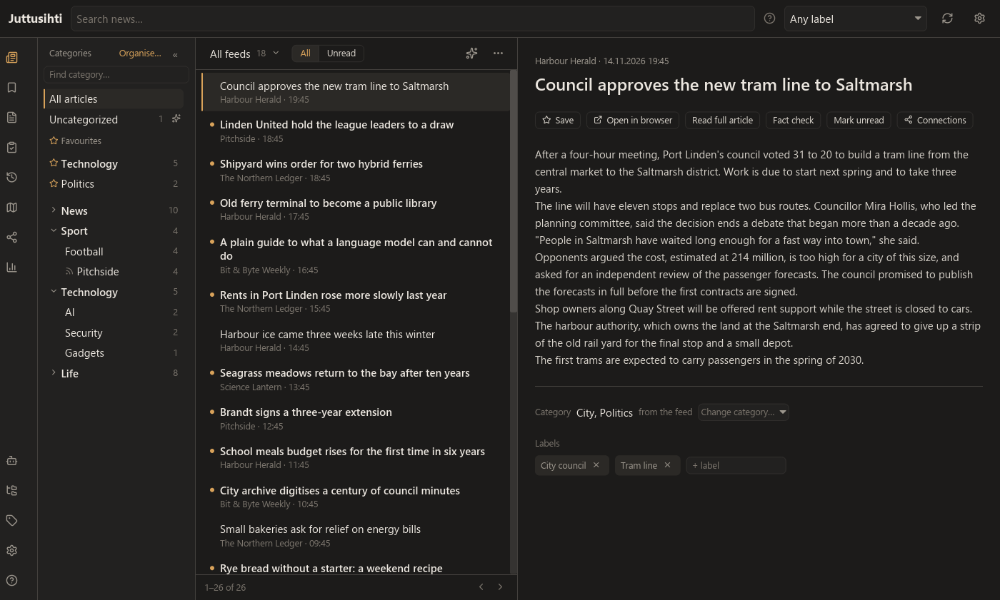
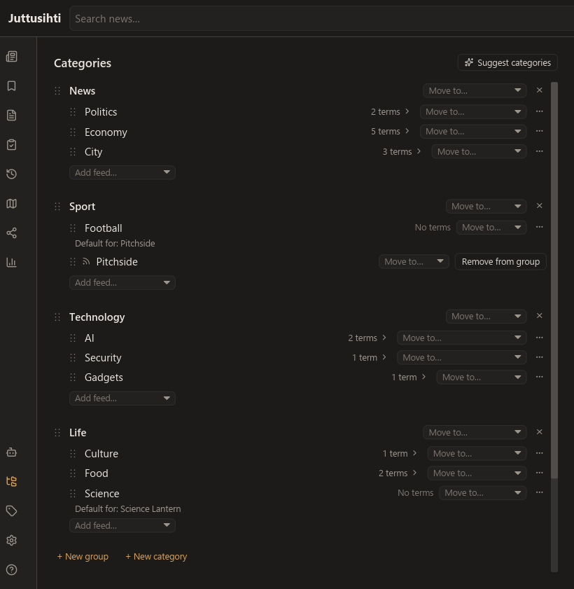
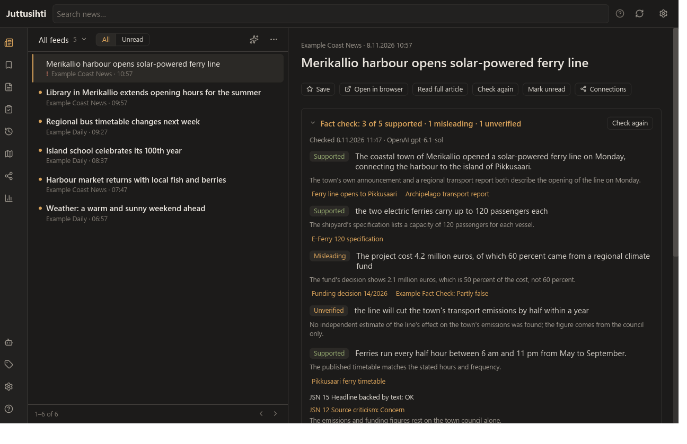
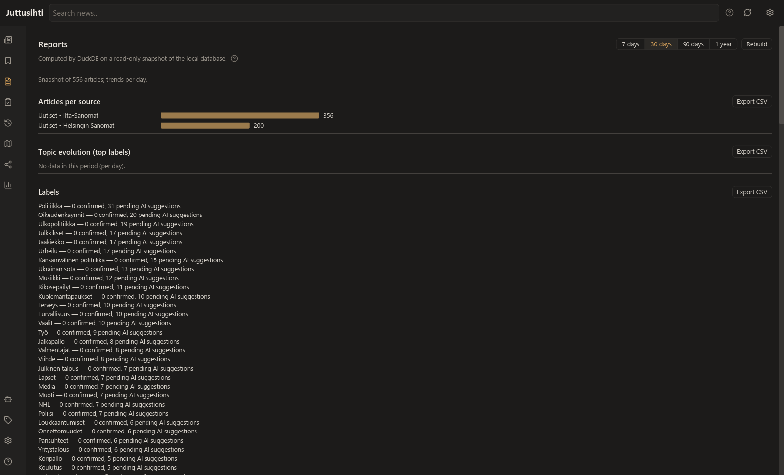
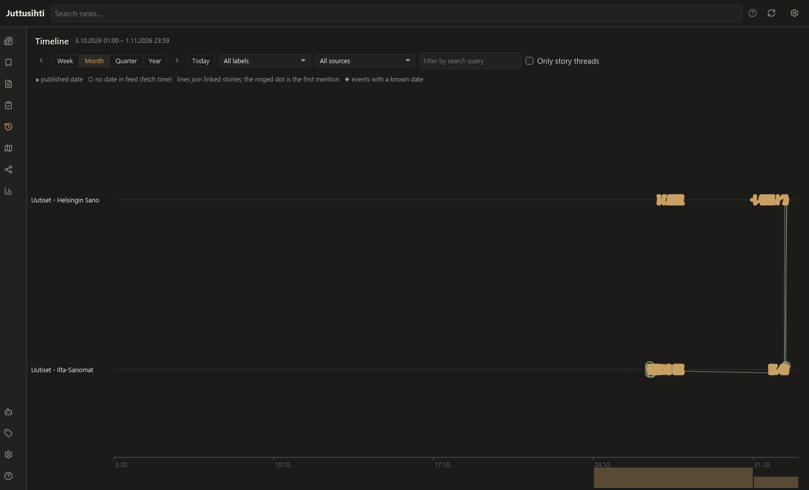

<p align="center">
  
</p>

<h1 align="center">Juttusihti</h1>

<p align="center"><b>Your news, sifted by you. A private RSS reader for Windows and Linux.</b></p>

<p align="center">
  <a href="https://github.com/tero-k/juttusihti/actions/workflows/ci.yml"></a>
  <a href="https://github.com/tero-k/juttusihti/releases"></a>
  <a href="#license"></a>
</p>

Most news reaches us through feeds someone else arranges: ranked to keep us scrolling, with
headlines written to be clicked and our reading habits sold on. Juttusihti is built for the
opposite.

- **You choose the sources.** Subscribe to the sites you trust. Nothing is ranked, promoted or
  hidden for you; the newest article is simply on top.
- **Clickbait loses its grip.** Headlines that tease can be rewritten from what the article
  actually says, with the original shown underneath.
- **Your reading stays yours.** Everything is stored in one database on your own computer.
  There is no account, no ads and no tracking of what you read.

The name is Finnish: *juttu* is a story, *sihti* a sieve.



## What you can do with it

- **Read in peace.** Add a site and Juttusihti finds its feeds. Folders, unread and saved
  views, keyboard shortcuts, offline reading, OPML import and export.
- **Read the whole article.** When a feed gives only a teaser, one click fetches the full text
  in a throwaway private browser that blocks known trackers and ads, then deletes itself.
- **Find things again.** Fast full-text search on your own computer, with phrases, `OR`,
  `NOT` and field filters.
- **Sort the news your way.** Categories and groups in a sidebar, built from the section names
  publishers already send. A feed can have a default category, and a feed can sit in a group.
- **See through headlines.** Clickbait headlines rewritten from the article text, always marked
  as AI, with the original underneath.
- **Check a claim.** One button has an AI check an article's factual claims against web
  sources, Wikipedia and published fact checks, and shows its sources.
  ([How it works](docs/fact-check.md))
- **Step back and see the picture.** Labels, people and places, story threads, a timeline, a
  map and reports of what your sources write about.

| | |
| --- | --- |
|  |  |
|  |  |

Screenshots use made-up demo news.

## Your privacy

Juttusihti talks to the network only when it has to, and only for what you asked:

- **Your feeds**: it fetches them from the publishers, like any reader.
- **A full article**: only when you press the button, in a fresh browser profile that is
  deleted afterwards. The site still sees your IP address, as with any visit.
- **AI**: only when you start a run. See below.
- **Map tiles**: off until you turn them on.

Everything else, including search, categories and reports, happens on your computer. Your
data is one SQLite file you can copy, back up or delete.

## AI is optional, and you stay in charge

Juttusihti works fully without AI. If you want it, connect your own provider: sign in with
ChatGPT, or use an OpenAI, Anthropic or Gemini API key (kept in your system's secret store).

- **Nothing is sent until you press the button.** Before every run you see what will be sent,
  to whom, and an estimate of the cost.
- **Spending limits** stop a run before it goes over.
- **AI suggests, you decide.** What AI produces waits for your review, and it never overrides
  a choice you have made. The one exception is the ✨ on Uncategorized, which files articles
  into categories directly.
- **The original is never changed.** Rewritten headlines and summaries sit beside the
  publisher's text, marked as AI.

## Download

Get the latest version from [GitHub Releases](https://github.com/tero-k/juttusihti/releases).
What changed in each version: [CHANGELOG.md](CHANGELOG.md).

| System | File | Install |
| --- | --- | --- |
| Windows 10/11 (x64) | `juttusihti_X.Y.Z_x64-setup.exe` | Run it. Installs for the current user; no administrator rights needed. |
| Windows, portable | `juttusihti-X.Y.Z-x86_64-windows.zip` | Unzip and run `juttusihti.exe`. |
| Debian, Ubuntu 22.04+ | `juttusihti_X.Y.Z_amd64.deb` | `sudo apt install ./juttusihti_X.Y.Z_amd64.deb` |
| Fedora, openSUSE, RHEL 10 and other RPM systems | `juttusihti-X.Y.Z-1.x86_64.rpm` | `sudo dnf install ./juttusihti-X.Y.Z-1.x86_64.rpm` (openSUSE: `sudo zypper install`) |
| Other Linux (x86_64) | `juttusihti_X.Y.Z_x86_64.AppImage` | `chmod +x` it and run it. |
| Linux, plain binary | `juttusihti-X.Y.Z-x86_64-linux.tar.gz` | Unpack and run `juttusihti`; needs the libraries listed under [Build from source](#build-from-source). |

Windows files are code-signed. Every release lists SHA-256 checksums in
`SHA256SUMS-linux.txt` and `SHA256SUMS-windows.txt`:

```sh
sha256sum -c SHA256SUMS-linux.txt --ignore-missing
```

Linux packages are built by GitHub Actions and carry
[build provenance attestations](https://docs.github.com/actions/security-for-github-actions/using-artifact-attestations):

```sh
gh attestation verify juttusihti_X.Y.Z_amd64.deb --repo tero-k/juttusihti
```

## Getting started

1. Install Juttusihti and open it.
2. Open the feed menu at the top left of the article list, paste a site address or a feed URL
   into **Add a site or feed** and press **Add**.
3. Coming from another reader? Export OPML there and use **Import OPML** in the feed menu.
4. Read. Press **F1** any time for the built-in guide.

## Learn more

- [User guide](docs/guide.md): reading, categories, full articles, search, AI, reports,
  settings. The same guide is in the app under **?** or **F1**.
- [Fact check](docs/fact-check.md): what is checked, what is sent where, and its limits.
- [Changelog](CHANGELOG.md): what changed in each version.
- [Development](docs/development.md): the code, tests, packaging and project status.
- [Benchmarks](BENCHMARKS.md): speed at 10,000 to 1,000,000 articles.

## Build from source

Requirements: Rust 1.85+ (2024 edition) and a C/C++ toolchain, because SQLite and DuckDB are
bundled and compiled from source. The full-article browser engine `juttusihti-browser` (see below)
needs Rust 1.88+. On Windows this means MSVC (VS 2022 Build Tools); CMake and
NASM are not needed. A first build of bundled DuckDB takes several minutes.

On Linux, install the development libraries first:
- Debian/Ubuntu: `libdbus-1-dev libxkbcommon-dev libwayland-dev libx11-dev libxcursor-dev
  libxi-dev libxrandr-dev libfontconfig1-dev libfreetype-dev`
- Fedora: `dbus-devel libxkbcommon-devel wayland-devel libX11-devel libXcursor-devel libXi-devel
  libXrandr-devel fontconfig-devel freetype-devel`

```sh
git clone https://github.com/tero-k/juttusihti.git
cd juttusihti
cargo run --release -p juttusihti
```

**Full articles need one more build command.** The app's browser engine, based on
[Servo](https://servo.org), is built as `juttusihti-browser` from its own cargo workspace
(`crates/browser`, with its own `Cargo.lock`, Rust 1.88+), so `cargo build --workspace` does not
build it. Build it into the same `target` folder, so the app finds it next to itself (or point
`JUTTUSIHTI_BROWSER` at it):

```sh
cargo build --release --locked --manifest-path crates/browser/Cargo.toml --target-dir target
```

Do not run a plain `cargo update` there: the lock file pins a pre-release crate. Servo also
needs LLVM/clang (set `LIBCLANG_PATH` if it is not found) and, for the first build, network
access to download a prebuilt SpiderMonkey; the first build takes a few minutes. On Windows it
needs a working OpenGL driver at run time. On Debian/Ubuntu add `clang libclang-dev cmake
pkg-config python3 libegl1-mesa-dev libgles2-mesa-dev libglib2.0-dev libharfbuzz-dev
libxcb-render0-dev libxcb-shape0-dev libxcb-xfixes0-dev`; at run time it needs `libegl1`, and
with no GPU or display Mesa's `libegl-mesa0` and `libgl1-mesa-dri` (software OpenGL). The Linux
dependency list is checked in CI on Ubuntu 22.04 but not yet on a clean desktop machine. Without
the browser engine the rest of the app works as before: the **Read full article** button is
still shown, and pressing it reports that the browser engine is missing.

## Contributing

Bug reports, ideas and pull requests are welcome in
[GitHub Issues](https://github.com/tero-k/juttusihti/issues). Before opening a pull request,
run `cargo fmt --all`, `cargo clippy --workspace --all-targets -- -D warnings` and
`cargo test --workspace`; CI runs the same checks. Keep the [invariants](docs/development.md#invariants-enforced-in-code-and-tests) intact, and
update the in-app Help (`crates/app/src/help.rs`) and the [user guide](docs/guide.md) when you
change how something is used. [docs/development.md](docs/development.md) describes the crates,
CI, releases and packaging.

## Security

Please report vulnerabilities privately, not in public issues: see [SECURITY.md](SECURITY.md),
which also holds the threat model and the latest dependency audit.

## License

Licensed under either of [Apache License, Version 2.0](LICENSE-APACHE) or
[MIT license](LICENSE-MIT), at your option.

Unless you explicitly state otherwise, any contribution intentionally submitted for inclusion
in this work, as defined in the Apache-2.0 license, shall be dual licensed as above, without
any additional terms or conditions.

The bundled [Lucide](https://lucide.dev) icon font is under the ISC license, with some icons
under MIT (`crates/app/assets/LUCIDE-LICENSE.txt`). Map data © OpenStreetMap contributors.

The full-article browser engine embeds Servo (MPL-2.0) and bundles Readability.js (Apache-2.0), the
EasyList and EasyPrivacy filter lists (CC BY-SA 3.0) and autoconsent (MPL-2.0); see
[crates/browser/assets/LICENSES.md](crates/browser/assets/LICENSES.md), which every package
ships as `LICENSES-browser.md` next to `LICENSE-MIT` and `LICENSE-APACHE`.
