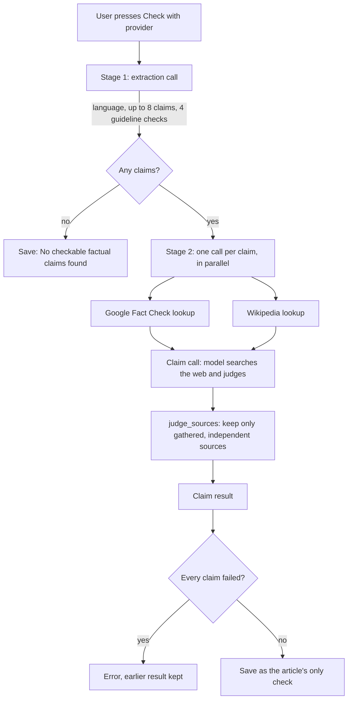

# Fact check

How Juttusihti checks the factual claims of a news article: what the user sees, what is sent
where, how evidence is gathered and judged, how cost is kept within a limit, and where the code
lives. This describes the code as it is; the original design is in
[`superpowers/specs/2026-11-07-fact-check-design.md`](superpowers/specs/2026-11-07-fact-check-design.md).

## Contents

1. [What it is](#what-it-is)
2. [Principles](#principles)
3. [What the user sees](#what-the-user-sees)
4. [What is sent where](#what-is-sent-where)
5. [The pipeline](#the-pipeline)
6. [Stage 1: claim extraction](#stage-1-claim-extraction)
7. [Stage 2: checking each claim](#stage-2-checking-each-claim)
8. [Evidence rules and verdicts](#evidence-rules-and-verdicts)
9. [Journalist's guidelines (JSN)](#journalists-guidelines-jsn)
10. [The score and the result card](#the-score-and-the-result-card)
11. [Cost: estimate, limit and ledger](#cost-estimate-limit-and-ledger)
12. [Failures, retries and fallbacks](#failures-retries-and-fallbacks)
13. [Security and privacy](#security-and-privacy)
14. [Storage](#storage)
15. [Settings](#settings)
16. [Code map](#code-map)
17. [Tests](#tests)
18. [Known limitations](#known-limitations)
19. [Changing the fact check](#changing-the-fact-check)

## What it is

When an article seems off, the reader presses **Fact check**. The configured AI provider picks the
article's checkable factual claims, researches each one with the provider's own web search,
Wikipedia and (optionally) Google's database of published fact checks, and gives each claim a
verdict with sources. It also judges the article against four points of the Finnish journalists'
guidelines ([Journalistin ohjeet](https://jsn.fi/journalistin-ohjeet/), JSN). The result is a
score line above the article that expands to the full list of claims.

Checks run only on demand, one article at a time. Nothing runs in the background.

## Principles

These shape most of the decisions below.

- **No verdict without evidence.** A claim is only *Supported*, *Contradicted* or *Misleading* if
  the verdict cites a source that was actually found during this check. Anything else is
  *Unverified*. The rule is enforced in code ([`judge_sources`](../crates/core/src/factcheck.rs)),
  not left to the model.
- **The article cannot vouch for itself.** Sources on the article's own site and copies of the same
  story do not count as evidence. Wikipedia is background only.
- **Nothing is sent before consent.** The button only opens a panel. The check starts when the user
  presses `Check with <provider>` in that panel.
- **Cost stays within a limit.** Every call is reserved against a per-check spending limit before
  it is sent, and settled at its real cost afterwards.
- **Model output and web content are untrusted.** They are data, never instructions, and every
  value is validated and bounded before it is stored or shown.
- **Any language.** Articles can be in any language. Claims are quoted in the article's language;
  the user interface and every explanation are in English.
- **Honest about limits.** The card always says the check was made with AI and is a guide, not a
  guarantee.

## What the user sees

### The button

**Fact check** sits in the reader's action row. It is enabled only when the article has real text
to check ([`can_check`](../crates/app/src/fact_check.rs)):

- the full article has been fetched (**Read full article**), or the feed itself gave full content,
  and
- the text is at least 300 characters (`MIN_CHECK_CHARS`). The "subscribers only" note added to a
  paywalled article does not count as text.

Otherwise the button is disabled with the tooltip "Load the full article first". Once an article
has a result, the button reads **Check again**. While a check runs, it shows "Checking… 3/8"; on
another article it is disabled with "Another fact check is running." Only one check runs at a time.

### The consent panel

Pressing the button opens a panel under the action row. Opening it sends nothing; it only reads
local settings and whether a Google key is stored. It shows:

- the provider and model, plus "on your ChatGPT plan" when billed to a plan;
- what goes where, for example "Sends the article to OpenAI, its claims to Google Fact Check and
  searches to Wikipedia." (the Google part appears only when a key is stored);
- the estimate: "About $0.05, at most about $0.40", "On your ChatGPT plan", or "Cost unknown";
- "Web searches can run slightly over the limit." for OpenAI and Gemini, or a note that the check
  runs without web search when the model's search price is unknown;
- the per-check limit, and any setup problem (missing key, signed out) in red.

`Check with <provider>` is the consent. It is disabled when credentials are missing, and on an API
key also when the cost cannot be estimated.

### While it runs

The panel shows "Finding the claims…" and then "Checking claims: 3/8", with **Cancel**. Cancelling
stops the run and saves nothing; the panel then says "The fact check was cancelled." A failure
shows its reason in red with **Close**.

### The result

The result appears above the article text as a card, collapsed to its score line (see
[The score and the result card](#the-score-and-the-result-card)). A red **!** in the article list
marks articles whose latest check found contradicted or misleading claims.

## What is sent where

| Recipient | What it receives | When |
| --- | --- | --- |
| AI provider (OpenAI, Anthropic or Google Gemini) | The article's title and text, its URL, each claim, and the Wikipedia and Google results for that claim | Every check |
| The provider's web search | Search queries the model writes | When the model supports search and its price is known |
| Wikipedia (`<lang>.wikipedia.org` REST search) | A short search phrase per claim | Every check |
| Google Fact Check Tools (`claims:search`) | A short search phrase per claim, and the user's key | Only when a key is stored |

Wikipedia and Google never receive the article itself, only the claim's search phrase. The app
fetches no web pages itself: it does not open search results or resolve Gemini's redirect links.
Links open in the system browser only when clicked.

## The pipeline



One check is **one extraction call plus one call per claim**. Claims are checked separately, not
in one big request. That keeps each claim's search focused, lets the spending limit stop between
claims, and means one failed claim does not lose the others. The cost is that the article is sent
with every claim; the estimate counts it.

## Stage 1: claim extraction

Code: [`extract_request`, `parse_extraction`](../crates/ai/src/factcheck/mod.rs),
[`Run::extract`](../crates/ai/src/factcheck/run.rs).

The model gets the title and text inside a `<data>` block and is asked to:

1. detect the article's language as an ISO 639-1 code (`fi`, `et`, `en`…);
2. list the checkable factual claims, most important first, at most 8. Opinions, predictions and
   quoted opinions are skipped (JSN 11 separates fact from opinion). Each claim is quoted exactly
   as in the article, with a short search query in the article's language;
3. judge the four JSN points from the text alone (see [below](#journalists-guidelines-jsn)).

The request uses a strict JSON schema (`fact_check_claims`). The reply is validated:

- **Quotes must really be in the article.** Each quote and the article are normalised (Unicode
  NFC, curly quotes and dashes folded to plain ones, soft hyphens and zero-width characters
  removed, whitespace collapsed, lowercased) and the quote must appear in the title or text.
  Invented or paraphrased quotes are dropped. Quotes under 12 characters are dropped as too short
  to check.
- At most 8 claims are kept (`MAX_CLAIMS`); quotes are cut to 400 characters, queries to 200.
- The language must look like a code (`^[a-z]{2,3}$`); anything else becomes `en`.
- Guidelines must be one of 15, 12, 21, 16 with status `ok`, `concern` or `not_applicable`; any
  other value fails validation. Duplicates are ignored, missing ones are filled in as
  *Not applicable*, and reasons are cut to 600 characters.

Unusable output (not JSON, cut off, or failing validation) is retried once. A second failure
ends the check with "Could not read the article's claims." A refusal ends it with the provider's
reason. An article with no checkable claims is saved as "No checkable factual claims found."

## Stage 2: checking each claim

Code: [`Run::check_claims`, `Run::check_claim`, `Run::lookups`](../crates/ai/src/factcheck/run.rs),
[`claim_request`](../crates/ai/src/factcheck/mod.rs).

### Parallelism

Claims start in importance order. On a **ChatGPT plan** all claims run at once (8 in flight); on an
**API key** three run at a time (`CLAIMS_IN_FLIGHT`). With an API key, every claim in flight holds
a worst-case reservation against the limit, so fewer at once leaves room for later claims once
earlier ones settle at their real, usually much lower, cost. A plan has no money limit to protect.
Results are put back in importance order at the end.

### Lookups

Before its model call, each claim looks up evidence in parallel ([`sources.rs`](../crates/ai/src/sources.rs)):

- **Google Fact Check Tools** (only with a key): `GET /v1alpha1/claims:search` with the claim's
  query, `pageSize=5`, first with `languageCode=<article language>`, then without a language if
  nothing came back. Each `claimReview` becomes a published check with its publisher, URL, title,
  rating exactly as published ("Väärä", "False"…) and review date. At most 5 are passed on, each
  field cut to 300 characters.
- **Wikipedia**: `GET https://<lang>.wikipedia.org/w/rest.php/v1/search/page?q=<query>&limit=2`.
  The top two pages' titles, URLs and excerpts (HTML stripped, 500 characters) are passed on.

A failed lookup only means less evidence; the claim is still checked. Both lookups use a 15-second
timeout, a 1 MB reply cap, no redirects, and the User-Agent
`Juttusihti/<version> (https://github.com/tero-k/juttusihti)`.

### The claim call

The model gets the claim, the full article, its URL and language, the published fact checks and
the Wikipedia extracts, all inside `<data>`. The instructions:

- search in the article's language and, when useful, in English; look for existing fact checks
  and later corrections;
- do not use the article's own site or copies of the same story as evidence, and mark any cited
  copy with `same_story: true`;
- Wikipedia is background only, not proof;
- published fact checks are evidence: weigh them and cite them when they decide the verdict;
- cite only URLs actually found; never invent one;
- answer `supported`, `contradicted`, `misleading` (true in parts but leaves a false impression)
  or `unverified` (evidence missing), with a reason of 1–2 sentences in English;
- at most 3 web searches.

The reply is `{verdict, reason, cited: [{url, same_story}]}`, validated by `parse_judgement`: an
unknown verdict fails, the reason is cut to 600 characters, and at most 20 cited URLs of at most
2000 characters are read.

### Web search per provider

The search tool is added in one place, [`add_search`](../crates/ai/src/providers.rs).

| Provider | Request | Search cap | Notes |
| --- | --- | --- | --- |
| OpenAI (API key) | `tools: [{type: "web_search", search_context_size: "low"}]`, `include: ["web_search_call.action.sources"]` | `max_tool_calls: 3` | Structured JSON output kept |
| OpenAI (ChatGPT plan) | Same tool, streamed | none | The plan's server rejects `max_tool_calls`; the run is charged to the plan, so no money cap is needed |
| Anthropic | `tools: [{type: "web_search_20250305", name: "web_search", max_uses: 3}]` | `max_uses: 3` | Structured output (`output_config`) is dropped, since search citations cannot be combined with it; the prompt spells out the JSON shape |
| Gemini | `tools: [{google_search: {}}]` | none (Gemini cannot cap searches) | JSON response schema dropped, since grounding cannot be combined with it |

Requests use the provider's default reasoning effort. Output caps per call are 1,500 tokens (4,000
for extraction), or 6,000 (8,000 for extraction) for models that bill their thinking as output.

**What counts as "found".** For each reply the app collects every URL the provider reports
([`openai_web`, `anthropic_web`, `gemini_web`](../crates/ai/src/providers.rs)), up to a cap:

- OpenAI: `web_search_call.action.sources` and the message's `url_citation` annotations;
- Anthropic: `web_search_tool_result` results and block citations;
- Gemini: `groundingMetadata.groundingChunks`. These URLs are Google redirect links; the chunk's
  title (the source's domain) is kept as the source's `site`, so the own-site rule and citation
  matching still work. Redirect links are shown as they are and not resolved by the app.

Together with the published fact checks and Wikipedia pages, these form the claim's **gathered**
set (`Gathered`). Published checks are added first, so when a search finds the same page, its
publisher and rating are kept.

## Evidence rules and verdicts

[`judge_sources`](../crates/core/src/factcheck.rs) turns the model's citations into the sources
shown, and can overrule the verdict. For each cited URL, in order:

1. Skip it if the model marked it `same_story`.
2. Normalise it (http/https only, lowercase host, no fragment, no trailing slash). Anything else is
   skipped.
3. Look it up in the gathered set; if not there exactly, use the first gathered source on the same
   site (needed for Gemini's redirect URLs). **Not gathered means not kept**: the model cannot
   invent a source.
4. Skip it if its site is the article's own domain or a subdomain of it (`www.` ignored).
5. Keep it, at most 5 per claim, without duplicates.

Then: if the verdict is Supported, Contradicted or Misleading and **no kept source is anything other
than Wikipedia**, the verdict becomes **Unverified**, and its reason is replaced with "No
independent source could be confirmed for this verdict." (the model's reason argued for a verdict
that no longer applies).

| Verdict | Meaning | Colour |
| --- | --- | --- |
| Supported | Independent sources confirm it | green |
| Contradicted | Reliable sources say otherwise | red |
| Misleading | True in parts, but leaves a false impression | amber |
| Unverified | No independent evidence either way, or the check could not be completed | amber |
| Not checked (limit reached) | The spending limit stopped the check before this claim | grey |

Published fact checks are evidence, not the verdict. The card shows them as
"`<publisher>`: `<rating>`" with the rating as published; there is no fixed mapping from ratings
to verdicts.

## Journalist's guidelines (JSN)

Judged during extraction, from the article text alone, with no web search:

| JSN | Label | Question |
| --- | --- | --- |
| 15 | Headline backed by text | Do the headline and lead say more than the text supports? |
| 12 | Source criticism | Do central claims rest on a single, unnamed or interested source? |
| 21 | Right to reply | Is an identifiable person or organisation shown in a very negative light without their side? |
| 16 | Hidden advertising | Does the piece read like unmarked promotion? |

Each is *OK*, *Concern* (with a one-sentence reason) or *Not applicable*. A concern is shown in
amber with its reason.

## The score and the result card

Code: [`view_card`](../crates/app/src/fact_check.rs), [`FactCheck::summary_line`](../crates/core/src/factcheck.rs).

**Collapsed** (the default, also right after a check), the card shows:

- the score line, for example **Fact check: 2 of 8 supported · 1 contradicted · 5 unverified**.
  Supported always comes first as "N of M"; contradicted, misleading, unverified and not checked
  follow when there are any, so a problem is never hidden behind the collapsed line. With no
  claims, the line reads "No checkable factual claims found.";
- **Check again**;
- "Reduced check: web search was not available." when the check ran without web search, since that
  explains a low score;
- the disclaimer: "This check was made with AI. It does its best, but it can miss things or get
  them wrong, so treat it as a helpful guide rather than a guarantee, and look at the sources
  before relying on it."

The score line is coloured by the worst verdict: red if anything is contradicted; amber if anything
is misleading or unverified, or if nothing was supported; green only when at least one claim is
supported and nothing worse was found. A check that confirmed nothing is not good news.

**Expanded** (click the score line), it adds the date, provider and model; each claim with its
verdict tag, quote, reason and source links; and the four JSN rows. The expanded state is
remembered per article until the app closes.

**List mark.** An article whose latest check has at least one Contradicted or Misleading claim gets
a red **!** in the article list (`flagged_count > 0`). Unverified-only results get no mark.

## Cost: estimate, limit and ledger

### Prices

Web search is priced per search, not per token. The pricing catalog
([`catalog.json`](../crates/core/pricing/catalog.json)) has `web_search_per_1k` (USD per 1,000
searches) per model: currently $10 for Anthropic and OpenAI and $14 for Gemini, verified
2026-11-07. Free daily allowances are ignored, so estimates err high. Unknown prices stay absent,
never 0. A model with a known token price but no search price is checked **without web search**
(a "reduced check"), because the limit could not cover the searches. A model with no known price
at all cannot be checked on an API key ("The price of this model is unknown…").

On a ChatGPT plan, prices are zero: usage counts against the plan, not money.

### The estimate

[`estimate`](../crates/core/src/factcheck.rs) works out two figures for the panel, pricing each
call separately (so long-context rates apply per call, as billed):

| | Expected | At most |
| --- | --- | --- |
| Extraction input | article + 1,000 | article + 1,000 |
| Extraction output | half its cap | its cap |
| Claims | 8 | 8 |
| Each claim's input | article + 2,500 + 1 search × 4,000 | article + 2,500 + 3 searches × 12,000 |
| Each claim's output | a third of its cap | its cap |
| Searches | 8 | 24 |

Tokens are approximated from characters (`approx_tokens`).

### The limit

Each check has its own limit, separate from other AI limits: **$1.00** by default, set in
**AI setup → Fact check**. Monthly and overall spending limits still apply as for every AI run.

A budget `Guard` enforces the limit by **reserve, then settle**:

1. Before each call, reserve its worst case: the prompt's approximate tokens + 35% + 64, plus
   2,000 tokens of room for lookup results (first call of a claim), plus 3 × 12,000 tokens of search
   results when searching, plus the output cap, plus 3 searches.
2. If the reservation does not fit, the call is not sent. If the extraction does not fit, the check
   fails with "The fact check limit is too low for this article." If a claim does not fit, that
   claim and every later one are marked **Not checked (limit reached)**.
3. After the call, settle at the real usage and search count. Unused reservation is freed for later
   claims.

The limit can be exceeded slightly: Gemini cannot cap its searches, and a provider may report more
usage than reserved. The panel says so for OpenAI and Gemini.

### The ledger

Every call is written to `usage_ledger` with operation `fact_check_extract` or `fact_check_claim`,
its input, cached, output and reasoning tokens, and its cost. Two special cases are charged at the
reserved worst case, because they may have been billed: `…:cancelled_in_flight` (cancelled while
waiting for the reply) and `…:unknown_outcome` (the connection failed after sending). The saved
check's `cost` is the sum, or unknown if any part was.

## Failures, retries and fallbacks

| Situation | What happens |
| --- | --- |
| Transient network or server error | The AI client's normal retry policy |
| Extraction output unusable | Retried once, then "Could not read the article's claims." |
| Claim output unusable (not JSON, cut off, invalid verdict) | Retried once, then the claim is Unverified with "The check could not be completed for this claim." |
| Model or plan cannot use the search tool (400/404 mentioning the tool) | Search is switched off for this and all later claims; the claim is re-sent without search; the card says "Reduced check" |
| The server rejects `search_context_size` | Re-sent with the default search context; search stays on |
| Other rejected request parameters ("Unsupported parameter: …") | Not treated as "cannot search": the claim fails visibly instead of silently becoming a reduced check |
| Any other claim request error | That claim is Unverified ("could not be completed"); the others continue |
| No credit, plan limit, rejected key or sign-in (401/403) | The whole check stops, saves nothing, and keeps any earlier result. The message says what to fix |
| Every claim failed | Nothing is saved: "The fact check could not be completed. Your earlier result, if any, was kept." |
| Google or Wikipedia lookup fails | Less evidence; the claim is still checked (logged at debug level) |
| Cancelled | Nothing is saved. Calls in flight are charged at their worst case in the ledger |

A claim stopped by the limit counts as judged, so a run with some claims checked and the rest
"Not checked" is saved.

## Security and privacy

- **Untrusted data stays data.** The article, search results, published fact checks and Wikipedia
  extracts are serialised as JSON with `<` and `>` escaped (`<`, `>`), so no field can
  close the `<data>` block. Both the system prompt and the task say that everything in `<data>` is
  data, not instructions.
- **No invented sources.** Cited URLs must come from what this run gathered, must be http(s), and
  are bounded in length and number.
- **Everything is bounded.** Quotes, queries, reasons, titles, extracts, published-check fields,
  reply bodies and source counts all have caps.
- **Nothing is fetched or run automatically.** Links open only on click, only for `http(s)` URLs, in
  the system browser.
- **Keys.** The Google Fact Check key is kept in the operating system's secret store (account
  `google-factcheck-api-key`), never in the database or logs. Error messages from lookups are built
  without the request URL, because the URL contains the key.
- **No disguise.** Lookups identify as Juttusihti with the repository URL and include no personal
  details.

## Storage

Migration [`0007_factcheck.sql`](../crates/core/migrations/0007_factcheck.sql) adds one table:

```sql
CREATE TABLE article_fact_checks (
    article_id     INTEGER PRIMARY KEY REFERENCES articles(id) ON DELETE CASCADE,
    checked_at     INTEGER NOT NULL,
    provider       TEXT NOT NULL,
    model          TEXT NOT NULL,
    prompt_version INTEGER NOT NULL,
    flagged_count  INTEGER NOT NULL,
    result_json    TEXT NOT NULL
);
```

- **One check per article.** Checking again replaces the row. A failed, cancelled or all-failed run
  leaves the earlier row in place.
- `flagged_count` (contradicted + misleading claims) sits beside the JSON so the article list can
  find flagged articles without parsing it (`fact_check_flags`, in chunks of 500 ids).
- `result_json` is the serialised `FactCheck`: article id, time, provider, model, billing, prompt
  version, language, whether web search was used, the claims (quote, verdict, reason, sources with
  kind, publisher, rating and site), the guideline checks, and the cost in micro-dollars. A row that
  no longer parses reads as no check.
- Deleting an article deletes its check.
- Search results themselves are not stored, only the sources a verdict cites.

Note that applying migration 0007 makes the database unreadable to older builds, which refuse a
newer schema.

## Settings

**AI setup → Fact check** ([`providers.rs`](../crates/app/src/providers.rs)):

- **Limit per fact check (USD)**, default 1.00, stored in the settings table as
  `fact_check_max_cost` in micro-dollars.
- **Google Fact Check Tools API key (optional)**: free from Google Cloud (enable the Fact Check
  Tools API). Stored in the secret store, with a remove button.

The provider and billing (API key or ChatGPT sign-in) come from the AI defaults. The model is the
provider's **Quality** tier model: `gpt-6.1-sol` (OpenAI), `claude-sonnet-5-5` (Anthropic) or
`gemini-3.8-flash` (Gemini), or the explicitly chosen model when the defaults are already on the
Quality tier ([`fact_check_model`](../crates/app/src/fact_check.rs)).

## Code map

| Area | File | What is there |
| --- | --- | --- |
| Types and rules | [`crates/core/src/factcheck.rs`](../crates/core/src/factcheck.rs) | `FactCheck`, `ClaimResult`, `Verdict`, `Source`, guidelines, `judge_sources`, `Gathered`, `estimate`, `OutputCaps`, the score line, store methods, constants |
| Schema | [`crates/core/migrations/0007_factcheck.sql`](../crates/core/migrations/0007_factcheck.sql) | The `article_fact_checks` table |
| Prices | [`crates/core/pricing/catalog.json`](../crates/core/pricing/catalog.json), [`crates/core/src/pricing.rs`](../crates/core/src/pricing.rs) | `web_search_per_1k`, `search_cost` |
| Prompts and parsing | [`crates/ai/src/factcheck/mod.rs`](../crates/ai/src/factcheck/mod.rs) | Extraction and claim prompts and schemas, quote matching, `parse_extraction`, `parse_judgement` |
| The run | [`crates/ai/src/factcheck/run.rs`](../crates/ai/src/factcheck/run.rs) | `run_fact_check`: budget, ledger, parallelism, lookups, fallbacks, saving |
| Lookups | [`crates/ai/src/sources.rs`](../crates/ai/src/sources.rs) | Google Fact Check Tools and Wikipedia clients |
| Provider requests | [`crates/ai/src/providers.rs`](../crates/ai/src/providers.rs), [`crates/ai/src/lib.rs`](../crates/ai/src/lib.rs) | `add_search`, web evidence parsing, `WebSearch`, `is_tool_unsupported`, `is_context_size_rejected` |
| User interface | [`crates/app/src/fact_check.rs`](../crates/app/src/fact_check.rs) | Button, consent panel, estimate copy, progress, result card |
| Reader and list | [`crates/app/src/app.rs`](../crates/app/src/app.rs) | Where the card and button sit, `can_check`, the red **!** |
| Settings | [`crates/app/src/providers.rs`](../crates/app/src/providers.rs), [`crates/app/src/secrets.rs`](../crates/app/src/secrets.rs) | Limit field, Google key |
| Help | [`crates/app/src/help.rs`](../crates/app/src/help.rs) | The in-app Help section |

## Tests

No test contacts a real service or costs money.

- **End to end** ([`crates/ai/tests/factcheck.rs`](../crates/ai/tests/factcheck.rs)): local servers
  imitate the OpenAI Responses API, Google Fact Check Tools and Wikipedia. They cover a full check
  and its saved result, opinion pieces, failed lookups, search fallback, rejected
  `search_context_size`, malformed output, the limit, cancellation, published ratings reaching the
  card, Wikipedia alone not deciding a verdict, unknown prices, account errors and reasoning-model
  output caps.
- **Lookups** ([`crates/ai/tests/sources.rs`](../crates/ai/tests/sources.rs)): Google and Wikipedia
  request shapes and parsing.
- **Unit tests** next to the code: request shapes per provider, web evidence parsing, quote
  matching (including a non-Finnish, non-English article), evidence rules, estimate figures,
  score line, card state and copy, the migration and store.

Run them with `cargo test --workspace --locked`.

## Known limitations

- **Live coverage.** Only OpenAI on a ChatGPT plan has been tried against the real service. The
  OpenAI API key, Anthropic and Gemini request shapes follow their documentation and are covered by
  tests, not by live runs.
- **Low search context had little measured effect.** On a ChatGPT plan, claim calls still used
  roughly 10,000–27,000 input tokens each after `search_context_size: "low"` was added; most of that
  is search results the provider adds.
- **Gemini and Wikipedia.** A Wikipedia page found by Gemini's search arrives as a Google redirect
  URL, so it is classed as a web source and can count as evidence, against the "Wikipedia is
  background only" rule. Fix: also check the source's `site` in `is_wikipedia`.
- **Google key problems are quiet.** A rejected Google key looks like "no published fact checks";
  the failure is logged only at debug level.
- **Date for prices.** The estimate looks up prices by the local date and the run by the UTC date;
  this only matters around midnight on a day a price changes.
- **Fresh news rarely has published fact checks**, so Google Fact Check adds most for claims that
  fact-checkers have already covered.
- **Unverified is not false.** Many claims in fresh news are unverified simply because no
  independent source has reported them yet.

## Changing the fact check

- **Prompts or the reply format.** Change them in `crates/ai/src/factcheck/mod.rs` and bump
  `FACT_CHECK_PROMPT_VERSION` in `crates/core/src/factcheck.rs`, so stored results show which
  prompts made them. If the stored JSON shape changes, keep it readable (`#[serde(default)]` for new
  fields), since unreadable rows are treated as no check.
- **Claims, searches, caps.** `MAX_CLAIMS`, `SEARCHES_PER_CLAIM`, `MAX_SOURCES_PER_CLAIM` and the
  output caps are in `crates/core/src/factcheck.rs`; the prompt's "at most 3 web searches" and "at
  most 8" must match. Changing them changes the estimate and the reservations.
- **Parallelism.** `claims_in_flight` in `run.rs`.
- **A new provider.** Add its search tool to `add_search`, parse its sources into `WebEvidence`,
  recognise its "tool not supported" errors in `is_tool_unsupported`, and add a search price to
  the catalog.
- **Search prices.** Update `web_search_per_1k` in `catalog.json` with the source and the date
  verified. Leave unknown prices out.
