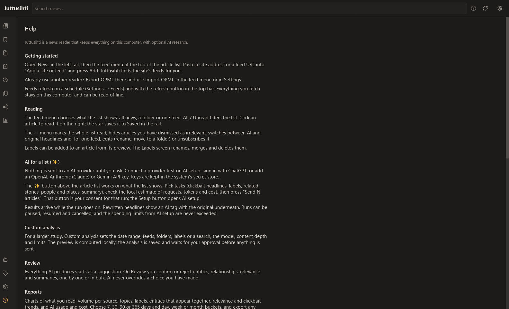
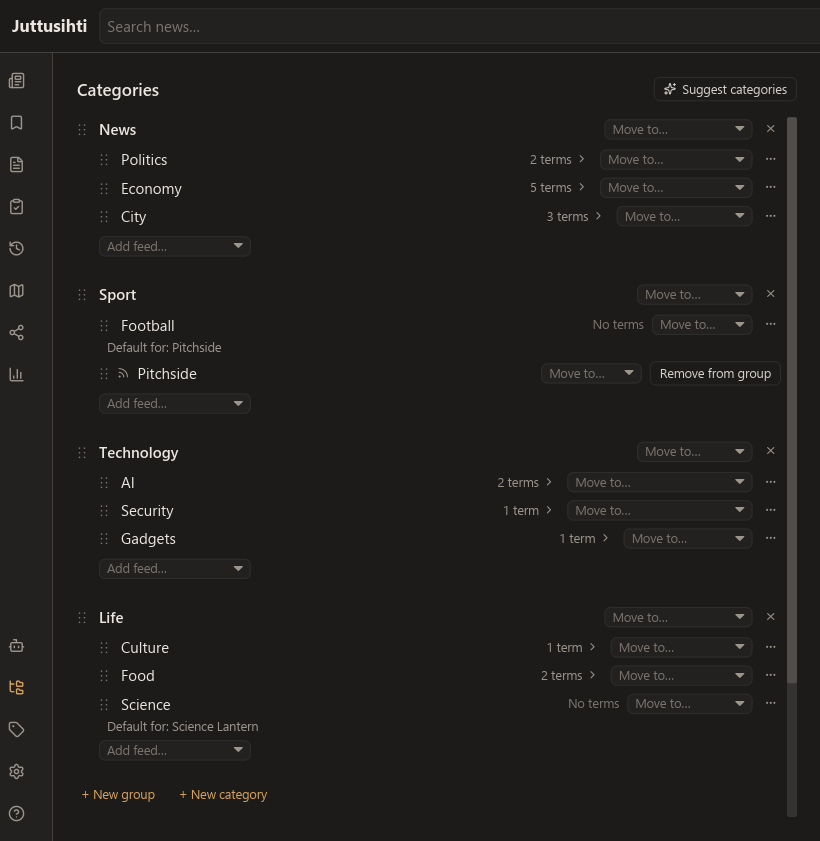
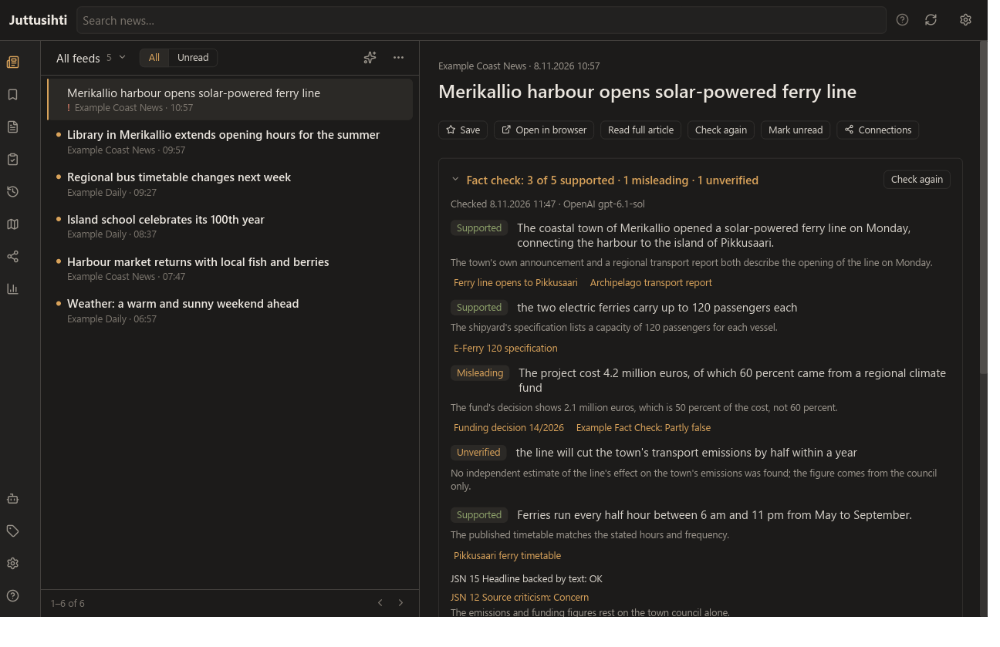
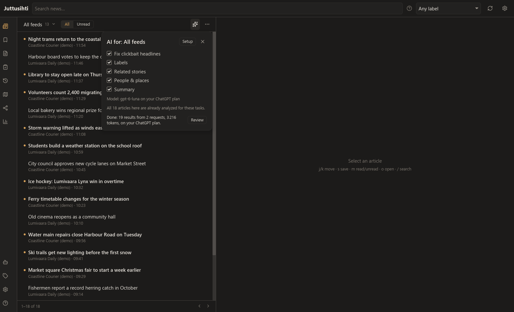
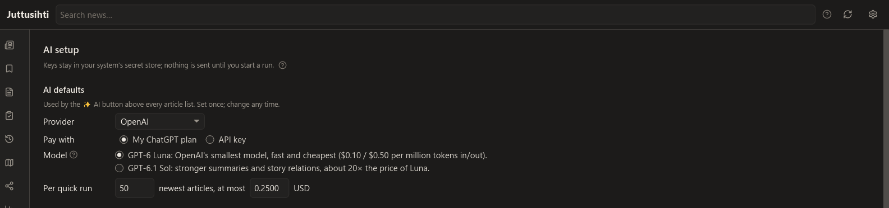
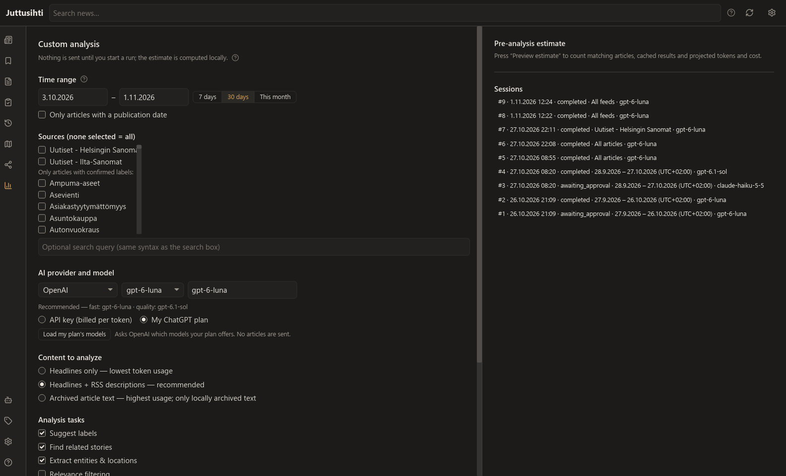
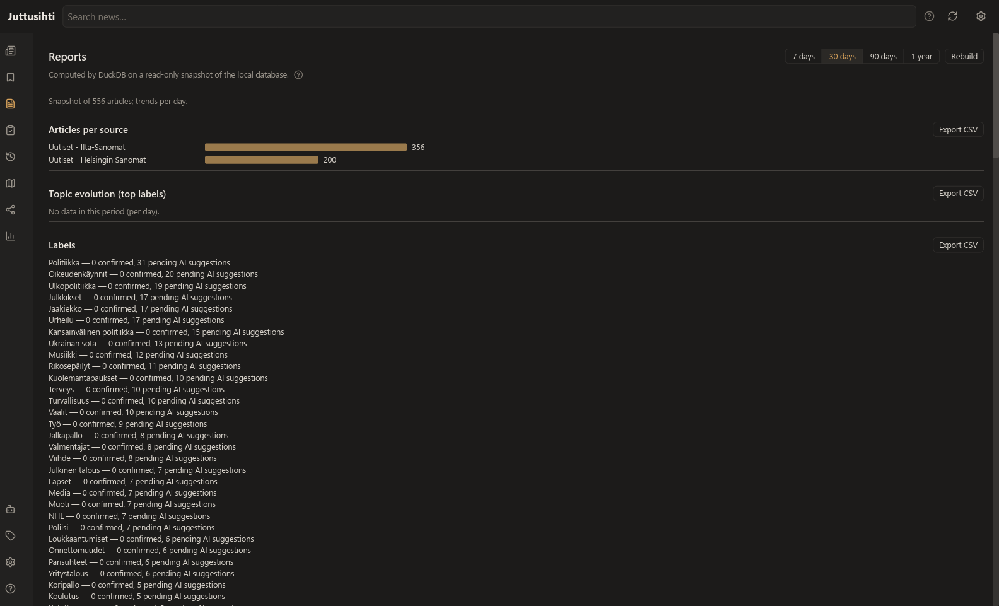
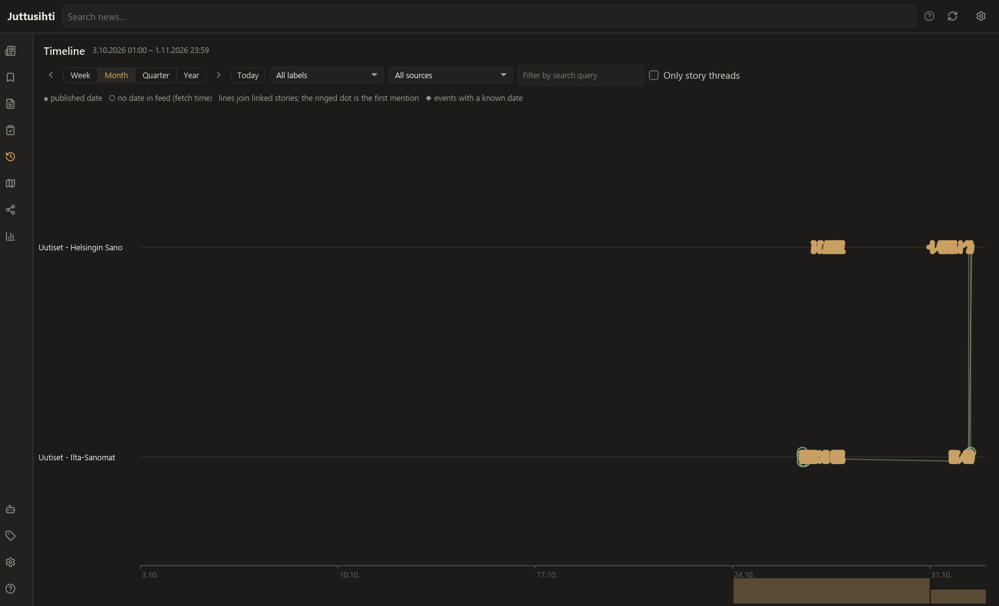
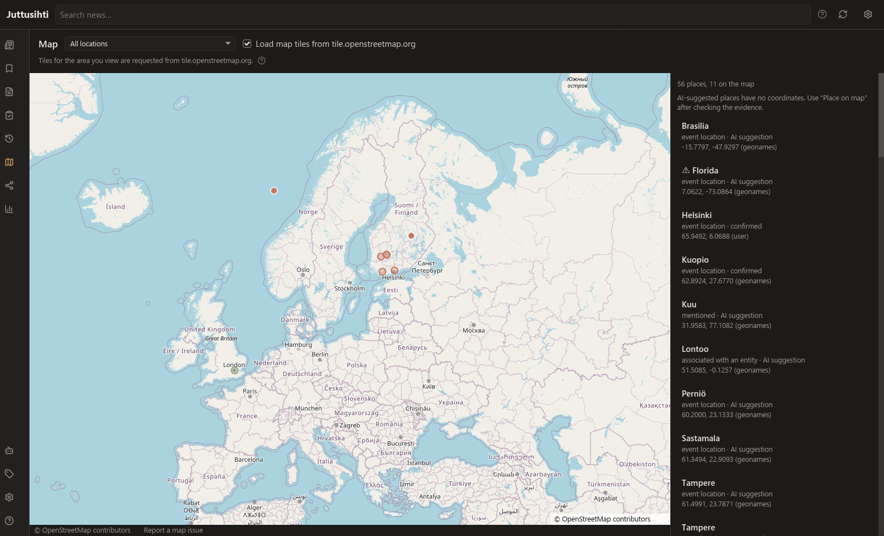
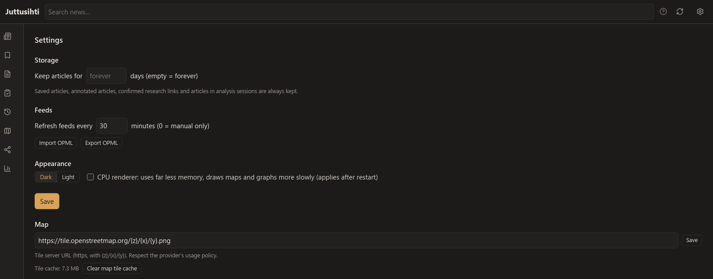

# Using Juttusihti

The same guide is built into the app: click **?** at the bottom of the left rail, or press
**F1**.

## Getting started

1. Open **News** (the newspaper icon at the top of the left rail).
2. Open the feed menu at the top left of the article list. Paste a site address or a feed URL
   into **Add a site or feed** and press **Add**. Juttusihti finds the site's feeds for you.
3. Coming from another reader? Export OPML there and use **Import OPML** in the feed menu or
   in Settings.

Feeds refresh on a schedule (Settings → Feeds, every 30 minutes by default) and with the
refresh button in the top bar. Everything you fetch stays on this computer and can be read
offline.

## Reading

- The feed menu chooses what the list shows: all news, a folder or a single feed. **All /
  Unread** filters the list.
- Click an article to read it on the right. **Save** keeps it under **Saved** in the rail and
  protects it from the retention clean-up; **Open in browser** opens the original page.
- The **⋯** menu marks the list read, hides articles you have dismissed as irrelevant,
  switches between AI-rewritten and original headlines and, for a single feed, renames it,
  moves it to a folder, sets its default category and category group, or unsubscribes.
- Add labels to an article from its preview. The **Labels** screen renames, merges and deletes
  them. The article's **Category** row shows its category and lets you change it; see
  [Categories](#categories).
- **Read full article** (shortcut **a**) fetches the whole article when the feed only has a
  teaser; see [Full articles](#full-articles).
- **Fact check** has an AI check the article's claims; see [Fact check](#fact-check).

## Categories

The sidebar between the rail and the article list picks a group or a category: All articles, your
★ Favourites, Uncategorized, then the groups and Ungrouped. Feeds you put in a group are listed under it
after its categories, with a feed icon; click one to see that feed's articles. The numbers follow All / Unread
and the feed menu. "Find category…" finds a category, group or feed by name (Esc or ✕ clears it), right-click or the star on hover adds a row
to Favourites, and drag reorders. **«** hides the sidebar and **»** (or **c**) shows it again;
**Organise…** opens the Categories screen.

**Uncategorized** lists the articles in no category; an article that is in a group only through
its feed is still uncategorized. Its ✨ has AI find categories for the next 100 uncategorized
articles whose feed gave no categories (or only ones you ignored) and has no default category: a
small panel shows what is sent (their headlines and descriptions and your group and category
names), the estimate and the per-run limit before anything is sent. The AI gives each article one
main category and may create new ones, filed under one of your groups (Ungrouped when none fits;
it never creates groups); the results are saved directly, without Review.
Articles it has checked are not sent again, and each press handles the next newest ones.

On the Categories screen, **+ New group** and **+ New category** add them; drag a category onto
a group (or use **Move to…**) to file it. Publisher categories, the section names a feed gives its
articles, are collected as terms and filed under the category with the same name: at once when
you have one, otherwise in a new category in Ungrouped once the name is on two articles ("Kotimaa"
from two feeds lands in one category). Until then a one-off name, such as a player or a place,
waits under **Unsorted terms**. Move a term to another category with **Move to…**, or to
**Unsorted**, or **Ignore** it; your choice stays at later refreshes. Publisher categories are collected from now on; articles fetched earlier get
them only if they are still in the feed at the next refresh.

**Feed defaults and feeds in groups.** Some feeds send no publisher categories but stay on one
theme. Give such a feed a **default category** in its edit form (**Edit feed**, in the feed menu
or the **⋯** menu): it files the feed's articles whose publisher categories give no category,
old articles too, and those articles are never sent to the ✨. Its publisher categories are not
filed automatically while it has a default (file one by hand if you want it); clearing the default
lets them be filed at the next refresh and brings back any category AI had given its articles. A feed can also sit in one **group**, so all of its articles show
under that group whatever their categories. Pick the group in the edit form, or type a name in
"or new group" to create the group and file the feed in one step. On the Categories screen,
**Add feed…** in a group files a feed there; drag a feed row to another group or to Ungrouped,
or use **Remove from group**. A category lists the feeds it is the default for (**Default for:**).

An article's categories are worked out in this order: the one you set wins; otherwise the
categories its publisher categories are filed under; if none, its feed's default category; if
none, the category AI gave it.

Categories are separate from labels: labels serve search and analytics, categories a quick short
list for filtering. In the article view, the **Category** row shows the article's category and
where it came from (from the feed, the default of its feed, from AI, or set by you); pick another to change it, or
**Automatic** to clear your choice and return to the feed's or the AI's.

**✨ Suggest categories** asks your AI to sort your ungrouped categories into groups, and to file
the publisher terms still in Unsorted. Your groups stay as they are and keep what is in them; the
AI proposes new groups for the sections they do not cover, and a new category that fits no group
goes to Ungrouped. It first shows what will be sent (the publisher terms with their feed titles,
plus your group and category names; no article text) and an estimate, and sends only when you
consent. Tick the ungrouped categories you want put into groups (**All** and **None** help with
a long list): only those are grouped, and the others stay in Ungrouped. The answer is an editable draft; nothing is saved until you press **Approve**.

## Full articles

Many feeds give only a headline and a teaser. To read the whole story inside Juttusihti:

1. Open the article in the reader.
2. Press **Read full article** next to **Open in browser**, or press **a**. The button shows
   **Fetching…** for about 5 to 10 seconds.
3. The whole text replaces the teaser and the button says **Fetched**. The main picture is
   shown faded behind the headline. The article now opens instantly, also offline.

Subscriber-only articles keep only the part the site shows everyone, with the note "The rest
of this article is for subscribers." Juttusihti never gets around a paywall. If a fetch does
not work, the reader says why: "Couldn't find the article text on the page." (this is also
what a site that refuses the visit looks like) or "The site took too long to answer." The
teaser and **Open in browser** stay as they were.

Fetched text is included in search, and in **Custom analysis** when you choose **Archived
article text**.

### Privacy

Nothing is fetched until you press the button. Then Juttusihti's built-in browser engine loads
the page in the background, with no window and a brand-new, empty profile, so the site sees a
stranger with no earlier cookies or logins:

- Known trackers and ads are blocked with the EasyList and EasyPrivacy lists, which ship with
  the app; no rules are downloaded at run time.
- Cookie banners are accepted automatically, including the free choice of "consent or pay"
  walls, so you never click one. This is deliberate: the alternative is often a page with no
  text. Because the profile is new, the cookies only live for that one visit.
- When the text and the main picture are saved, the whole profile, cookies, storage and cache
  included, is deleted, so the next visit cannot be linked to this one. If the engine crashes
  or hangs, the profile is still deleted, and any leftovers are cleared when the app starts.
- The site still sees your IP address, as with any visit.
- The text and picture are stored on this computer, apart from the feed. They are never sent
  to an AI provider unless you include the article in an AI run.

### Cache

Settings → **Full articles**:

- **Download pictures**: on by default. Off means text only; the picture is never requested.
- **Cache size limit**: 500 MB by default. When the cache is full, the oldest fetched articles
  fall back to their feed teaser first; they can be fetched again. Saved articles are never
  removed to make room.
- **Clear cache now** removes all fetched text and pictures.

## Fact check

Press **Fact check** in the reader, after **Read full article**, to have an AI check the factual
claims of an article. It needs the full text: until the article is fetched (or the feed gave at
least 300 characters of full content) the button is disabled, and its tooltip says "Load the full
article first". Once there is a result it says **Check again**.

The button only opens a panel with the provider and its Quality model, what will be sent where,
an estimate and the limit for one check. Nothing is sent until you press
`Check with <provider>`:

- the article goes to your AI provider;
- the claims go to [Google Fact Check Tools](https://developers.google.com/fact-check/tools/api),
  only if you added a key;
- searches go to Wikipedia.

The AI picks up to 8 checkable factual claims (opinions are skipped), searches the web with the
provider's own search (up to 3 searches per claim), looks up Wikipedia and, with a key,
published fact checks. Each claim gets a verdict: **Supported**, **Contradicted**,
**Misleading**, **Unverified** or **Not checked (limit reached)**. Sources from the article's own
site or copies of the same story do not count, Wikipedia is only background, and a verdict needs
a real source found during the check, otherwise it becomes Unverified. Published fact checks
show the publisher and the rating as published.

The article is also checked against the Finnish journalists' guidelines
([Journalistin ohjeet](https://jsn.fi/journalistin-ohjeet/)): JSN 15 (the headline is backed by
the text), 12 (source criticism), 21 (right to reply) and 16 (hidden advertising).

The result appears above the article as a score, such as "Fact check: 2 of 8 supported ·
1 contradicted · 5 unverified"; click it to see each claim with its verdict, reason and sources,
and the guideline checks. Under the score a short note reminds that the check was made with AI and
is a helpful guide rather than a guarantee. "Reduced check: web search was not available." means
the model or plan could not search the web. A red **!** in the article list marks articles whose check found
contradicted or misleading claims.

**AI setup → Fact check** sets the limit per check ($1.00 by default) and the optional Google
Fact Check Tools API key (free from Google Cloud), kept in the system's secret store. Each claim
sets aside the most it could cost before it starts; if a check reaches the limit, the remaining
claims are marked Not checked, so raise the limit to check more. On a ChatGPT plan the limit does
not apply (a plan check costs no money) and the plan's own usage limits apply instead. Web
searches can run slightly over the limit with OpenAI and Gemini. Any article language works;
explanations are in English. Only the latest check per article is kept, and if credit or sign-in
runs out the check stops without replacing an earlier result.

How the check works in detail (prompts, evidence rules, cost limits, storage and code) is in
[fact-check.md](fact-check.md).

## Searching

Type in the search bar at the top (or press `/`). Search is local full-text search.
The label menu next to it narrows the list to articles with one label (confirmed labels only,
not pending AI suggestions); it works with or without search text, and **Clear** resets both.

| Query | Finds |
| --- | --- |
| `tram strike` | both words (AND is implicit) |
| `"city council"` | the exact phrase |
| `tram OR bus` | either word |
| `-sports` or `NOT sports` | leaves out articles with the word |
| `työttömyysturva*` | prefix; needed for Finnish inflections such as `työttömyysturvaan` |
| `title:sää` | only in the title (also `author:`, `summary:`, `content:`) |
| `NEAR(rail budget, 10)` | words within 10 words of each other; `( )` groups terms |

## Keyboard shortcuts

| Keys | Action |
| --- | --- |
| `j` / `↓`, `k` / `↑` | next / previous article |
| `o` / `Enter` | open the article in the browser |
| `a` | read the full article in the reader |
| `s` | save or unsave |
| `m` | mark read or unread |
| `n` / `p` | next / previous page |
| `/` or `Ctrl+F` | search |
| `Ctrl+R` | refresh all feeds |
| `Esc` | close menus and panels |
| `F1` | help |

## AI for a list (✨)

Nothing is sent to an AI provider until you ask.

1. Connect a provider on **AI setup** (the robot icon): sign in with ChatGPT, or add an
   OpenAI, Anthropic (Claude) or Gemini API key. The screen explains step by step how to get a
   key. Keys are stored in the system's secret store, never in the database. Set the default
   provider, Fast/Quality model and per-run spending limits here too.
2. Press **✨** above the article list. It works on what the list shows: a feed, a folder, a
   view or a search.
3. Pick tasks (clickbait headlines, labels, related stories, people and places, summary), check the
   local estimate of articles, requests, tokens and cost, and press **Send N articles to
   &lt;provider&gt;**. That button is your consent for that run.

Results show up in the list while the run goes on. Rewritten headlines carry an AI tag with
the original underneath. Runs can be paused, resumed and cancelled, and never exceed the
spending limits.

**Clickbait check.** With an OpenAI API key, headlines are checked before they are rewritten:
a fast, cheap classifier (OpenAI's Decisions API, `gpt-6-luna`) rates how likely each headline
is clickbait, in batches, and only those at or above the threshold (70% by default) are sent
to the rewriting model. Ratings are cached, so a new threshold costs nothing. Turn the check off
or change the threshold on **AI setup**. With Claude or Gemini, headlines are rewritten in one
step without the check.

**Ways to pay with OpenAI.** **Pay with** on **AI setup** and in **Custom analysis** has three
choices:

- **My ChatGPT plan**: everything counts against the plan, and headlines are rewritten in one
  step without the check.
- **API key**: everything is billed per token to the API account, including the check.
- **ChatGPT plan, with API credit for the clickbait check**: the check is billed to the API
  account and everything else counts against the plan. This needs both the sign-in and a key.

**API credit.** An API key is billed to the provider account behind it, which needs credit; a
ChatGPT plan is not. If your OpenAI API account runs out of credit, the run pauses at once and
says so instead of retrying. The exception is the split choice above: the plan still pays for
the rewrites, so the run goes on without the check and sends every headline for a rewrite. Add
credit on
[OpenAI's billing page](https://platform.openai.com/settings/organization/billing/), then press
**Resume** under **Custom analysis**: finished work is kept and never paid for twice.

## Custom analysis

For a larger study, **Custom analysis** chooses a date range, feeds, folders, labels or a
search, the model, how much of each article to send, tasks and limits. Its preview is
computed locally; the analysis is saved and waits for your approval before anything is sent.
Recent runs are listed there too, including ✨ runs; a paused or stopped run shows why it
stopped and has a **Resume** button.

## Review

Everything AI produces starts as a suggestion. On **Review** you confirm or reject entities,
relationships, relevance and summaries, one by one or in bulk. AI never overrides a choice you
have made. The one exception is the ✨ on Uncategorized, which saves the categories it
finds directly.

## Reports

Charts of your news: volume per source, topics, labels, entities that appear together,
relevance and clickbait trends, and AI usage and cost. Choose 7, 30, 90 or 365 days and day,
week or month buckets, and export any report as CSV.

## Timeline, map and relationship map

- **Timeline** shows articles per source, story threads and dated events. Drag to pan, scroll
  to zoom.
- **Map** shows places from articles. Map tiles stay off until you turn them on, because the
  area you view is then sent to the tile server; without them a coordinate grid is shown.
  Places named by AI have no coordinates: check the evidence and use **Place on map**.
- **Relationship map** draws people, organisations and places and how they connect: solid
  lines are confirmed, dashed lines are AI suggestions.

## Settings and your data

Settings sets how long articles are kept (saved and researched articles are always kept), the
refresh interval, dark or light theme, the CPU renderer (far less memory), full-article
pictures and cache size (see [Full articles](#full-articles)), and the map tile server and its
cache.

All data is in one SQLite database on this computer; its path is shown at the bottom of
Settings. Set `JUTTUSIHTI_DATA_DIR` to keep it somewhere else. Before an update changes the
database, a copy of it is saved next to it as `juttusihti-before-schema-N.db`; an older version
of Juttusihti can open that copy, but not the updated database.
